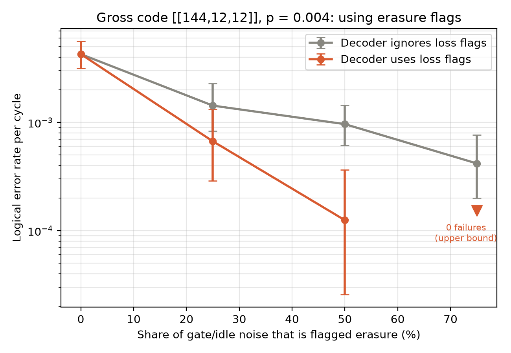
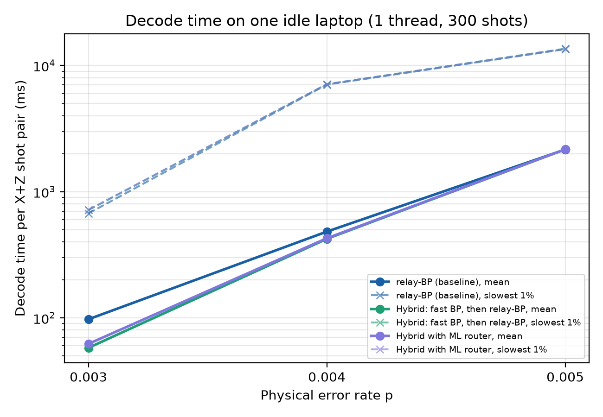

# MGC: erasure-aware decoding of the Gross code

Infleqtion Challenge 1 (ML-assisted QEC decoding), MidQWest 2026. See [AUDIT.md](AUDIT.md) for the submission readiness checks. The challenge brief is in [CHALLENGE.md](CHALLENGE.md).

**Question:** on neutral-atom hardware, some errors can be converted into *erasures* that come with a flag saying where they happened (idealized heralded erasure conversion; real atom loss is detected later, see limits). How much does a decoder gain on the [[144,12,12]] Gross code by using those flags, and can ML cut decoding time without losing accuracy?

## Results

### 1. Using erasure flags (headline)
**relay-BP, the strongest decoder in the kit, with the loss flags.** relay-BP has no per-shot prior update, so it is rebuilt for every shot (about 17 ms, included in its time) on the flag-blind matrix, with each flagged location's error probability raised (`lossy.fold_priors`, combining identical effects by parity). 50% of gate/idle noise flagged as erasure; the same shots are decoded with flags ignored and with flags used.

| p | Pairs | Flags ignored: failed pairs (rate/cycle) | Flags used | Failed only ignored / only used | Exact McNemar p | Mean time ignored → used | Slowest 1% ignored → used |
|---|---|---|---|---|---|---|---|
| 0.004 | 20,000 | 41 (1.7e-4) | **2** (8.3e-6) | 41 / 2 | 2e-10 | 176 → **80 ms** | 1,796 → **286 ms** |
| 0.005 | 10,000 | 138 (1.2e-3) | **6** (5.0e-5) | 134 / 2 | 2e-37 | 581 → **119 ms** | 7,677 → **711 ms** |

Roughly 20× fewer failed pairs, 2–5× faster on average and 6–11× faster on the slowest 1%. Timing was measured on one Apple laptop, 11 worker processes, both decoders on the same shots under the same load; read it as a ratio, not a latency guarantee. The ~20× is a ratio of small counts: the conservative reading is "over 10× fewer". Seeds 32 and 33 (p = 0.004) and 31 (p = 0.005); files `results/erase4_*`.


**BP-OSD with the loss flags** (the first experiment; the flags enter BP-OSD's priors through its per-shot update):
These results include the corrected herald-conditioned prior calculation (see [AUDIT.md](AUDIT.md)); the erasure runs were regenerated locally after the fix.
p = 0.004, 12 syndrome cycles, X and Z memory. The same simulated shots are decoded with flags hidden and with flags visible. Rates are logical errors per cycle with exact (Clopper-Pearson) 95% intervals.

| Noise flagged as erasure | Flags hidden (BP-OSD) | Flags used (BP-OSD) | Gain | Pairs |
|---|---|---|---|---|
| 0% | 4.3e-3 [3.2–5.6e-3] | 4.3e-3 (identical, as expected) | — | 1,000 |
| 25% | 1.4e-3 [0.8–2.3e-3] | 6.7e-4 [2.9–13e-4] | ~2× | 1,000 |
| 50% | 9.6e-4 [6.1–14e-4] | 1.3e-4 [0.3–3.7e-4] | **~7.7×** | 2,000 |
| 75% | 4.2e-4 [2.0–7.7e-4] | < 1.5e-4 (0 failures seen) | no failures to count | 2,000 |

**Paired test on identical shots** (pairs where only one of the two decoders failed; exact McNemar test):

| Noise flagged | Failed only with flags hidden | Failed only with flags used | p-value |
|---|---|---|---|
| 25% | 15 | 6 | 0.078 (not significant) |
| 50% | 20 | 0 | 1.9e-6 |
| 75% | 10 | 0 | 0.002 |

At 50%, 23 pairs failed with flags hidden versus 3 with flags used. At 50% and 75%, using the flags never caused a failure that the flag-blind decoder avoided; at 25%, 6 pairs failed only with flags (the 25% result is not significant). The "~7.7×" is the ratio of those counts, and its uncertainty is wide (the 95% intervals in the table above), so read it as "several times fewer".

**Scope:** this table is BP-OSD only; the relay-BP result above uses a different flag mechanism (rebuild per shot on the blind matrix) and needs no extra columns. The 0% row (4.3e-3 on 1,000 pairs) and the sweep's BP-OSD at p = 0.004 (4.3e-3 on 2,000 different pairs) agree.



- **Cost:** flag-aware BP-OSD is about 6.5× slower per shot at 50% erasure (about 9–10× at 25% and 75%), because the decoder considers each erasure component separately and its priors are updated every shot.
- **Why the flag-blind line also falls:** an erasure applies a random Pauli, and a quarter of those are the identity, so converting noise to erasure also lowers the effective error rate. The fair comparison is therefore flags hidden vs used **at the same erasure share, on the same shots**.

### 2. Required sweep: baselines and hybrid decoders
Logical error rate per cycle (95% CI) and failed pairs, same test shots for every decoder:

*Pairing:* X and Z runs that share a seed get the same Stim random stream, so their shots are correlated. Each X shot is therefore paired with a different, fixed random Z shot (`analyze.z_partner`), which makes the two halves of a pair independent, as in the kit's baseline. Every decoder uses the same pairs.

| p | relay-BP | BP-OSD | Hybrid (rule) | Hybrid (ML router) | Kit reference (relay / BP-OSD) |
|---|---|---|---|---|---|
| 0.003 | 3.3e-5 (2/5,000) | 3.2e-4 (19/5,000) | 3.3e-5 (2/5,000) | 3.3e-5 (2/5,000) | 4.2e-5 / 4.7e-4 |
| 0.004 | 6.3e-4 (15/2,000) | 4.3e-3 (100/2,000) | 6.3e-4 (15/2,000) | 6.3e-4 (15/2,000) | 8.7e-4 / 4.4e-3 |
| 0.005 | 6.8e-3 (158/2,000) | 2.3e-2 (492/2,000) | 6.8e-3 (158/2,000) | 6.8e-3 (158/2,000) | 6.9e-3 / 2.3e-2 |

Both hybrids have the same observed failed-pair count as relay-BP at all three tested noise levels; this finite sample does not prove equal underlying error rates. The hybrid is close to relay-BP with an early exit: relay-BP's first leg is BP, and the kit keeps running relay legs until 5 solutions have been found (`stop_nconv=5`) and returns the best of them, while the hybrid accepts BP's first converged answer.

**Decode time** (one idle laptop, 1 thread, 300 X+Z pairs per p):

| p | relay-BP mean / slowest 1% | Hybrid (rule) mean / slowest 1% | Hybrid (ML) mean | Shots escalated (rule) |
|---|---|---|---|---|
| 0.003 | 97 / 487 ms | **58** / 529 ms | 61 ms | 5% |
| 0.004 | 482 / 7,200 ms | 422 / 7,134 ms | 425 ms | 23% |
| 0.005 | 2,155 / 10,568 ms | 2,165 / 10,712 ms | 2,163 ms | 56% |




**Additional local comparison with both baselines:** Apple M5, 300 pairs per p, one worker/thread, under concurrent load. Entries are mean / p99 milliseconds per X+Z pair. Every decoder uses the same shots within this run. These are measured comparisons, not idle-machine latency guarantees.

| p | BP-OSD | relay-BP | Hybrid rule | Hybrid ML |
|---|---:|---:|---:|---:|
| 0.003 | 97 / 572 | 62 / 329 | 41 / 355 | 44 / 357 |
| 0.004 | 285 / 819 | 217 / 2604 | 200 / 2635 | 204 / 2638 |
| 0.005 | 503 / 970 | 1259 / 6954 | 1253 / 7063 | 1256 / 6958 |


### 3. The ML router (an honest negative result)
A gradient-boosted classifier reads the alarms per round and predicts whether fast BP will converge, so hard shots can skip it. (It also has a loss-flag-count input, but the sweep has no erasure, so that input is always 0.) Accuracy on held-out shots:

| p | ML router | One alarm-count threshold | Always guess the majority |
|---|---|---|---|
| 0.003 | 0.929 | 0.929 | 0.929 |
| 0.004 | 0.757 | 0.773 | 0.775 |
| 0.005 | 0.597 | 0.614 | 0.530 |

The router does not beat a single threshold. BP's own convergence check is already a good router: across all 14,166 test shots where fast BP converged, it was wrong on only 2 (both at p = 0.005).

**Upper bound for any router** (from the clean timing cache): even a *perfect* router, which skips BP exactly on the shots where it won't converge, would cut the hybrid's mean time by only 16.5% at p = 0.003, 7.8% at p = 0.004 and 3.7% at p = 0.005. Routing on convergence has little to gain. Learning would be better spent elsewhere, for example on per-shot priors.

### 4. QEC-Aegis: a learned risk model that catches wrong answers hidden behind convergence
`aegis/` (repository root) routes on a different question: *given that a fast, early-stopping relay-BP (tier 1) converged, is its answer wrong?* A calibrated gradient-boosted model reads tier-1, syndrome, temporal, loss and second-opinion features and sends risky shots to full relay-BP (tier 2). Models, tiers and threshold were chosen on validation shots and frozen (hashes in `experiments/reports/frozen_models.json`) before any test shot was decoded. Test shots are the frozen seed-2 records in `experiments/records/`, with X/Z pairs formed exactly as `analyze.py` does (`z_partner`). The online row is the routed decoder run as one program:

| p | Test pairs | relay-BP failed pairs | QEC-Aegis failed pairs | McNemar p | Mean ms, one worker: relay-BP → QEC-Aegis | Speedup [95%] |
|---|---|---|---|---|---|---|
| 0.003 | 30,000 | 26 | 33 | 0.25 | 34 → 12 | 2.9× [2.1–4.2] |
| 0.004 | 10,000 | 102 | 119 | 0.10 | 125 → 60 | 2.1× [1.7–2.8] |
| 0.005 | 5,000 | 404 | 398 | 0.75 | 988 → 885 | 1.1× [1.0–1.3] |

Error rates are statistically indistinguishable from relay-BP at every p; the point estimate is worse at p = 0.003 and 0.004 (LER ratio 1.27 and 1.17, both intervals include 1). Times are from separate single-worker timing shots (seed 5). The gain shrinks with noise as more shots need tier 2 (0.04%, 1.1% and 6.8% escalated), and at p = 0.005 the slowest 1% are slower than relay-BP. The required sweep (LER, latency percentiles and per-decoder resources for BP-OSD, relay-BP and QEC-Aegis side by side) is the first section of [docs/RESULTS.md](docs/RESULTS.md), followed by the oracle-router bound, erasure settings and calibration; verify with `scripts/verify_aegis.sh`.

## Where it works and where it falls short
- **Works:** using erasure flags gives large, statistically significant accuracy gains on the Gross code, for BP-OSD and for relay-BP; with relay-BP the flags also make decoding 2–5× faster. The simple hybrid keeps relay-BP accuracy and is ~1.7× faster on average at low noise (p = 0.003).
- **Falls short:**
  - The slowest 1% of shots do not get faster.
  - There is no speedup at p = 0.005.
  - Flag-aware *BP-OSD* costs about 6.5× more time at 50% erasure (flag-aware relay-BP is faster, not slower).
  - The ML router does not outperform the simple convergence rule.
  - Error bars at p = 0.003 are wide, with only 2–3 failures.
- **QEC-Aegis (section 4; numbers from [docs/RESULTS.md](docs/RESULTS.md), same test shots for all three decoders):**
  - *Works:* the hierarchy pays off where most shots are easy. Tier 1 settles 99.96%, 98.9% and 93.2% of shots at p = 0.003, 0.004, 0.005, so on one worker the median pair takes 4.4 vs 21.0 ms (relay-BP) at p = 0.003 and 6.2 vs 39.6 ms at p = 0.004; the mean is 2.9× and 2.1× faster and the slowest 1% 3.0× and 1.5× faster, at relay-BP accuracy (McNemar p = 0.25, 0.10).
  - *Works:* against BP-OSD it fails on 3–5× fewer pairs at every p (33 vs 157, 119 vs 552, 398 vs 1,256; LER ratio 0.21, 0.21, 0.29; McNemar p < 1e-24) and is 4.3× and 1.9× faster on average at p = 0.003 and 0.004.
  - *Works:* the learned risk model finds wrong answers that convergence alone cannot see. Escalating only non-converged shots (no ML) fails on more pairs at p = 0.004 and 0.005 (QEC-Aegis / rule LER ratio 0.84 and 0.91, McNemar p = 0.001 and 2e-4). On test shots the model ranks converged-but-wrong tier-1 answers with AUC 0.98, 0.96, 0.92.
  - *Works:* small footprint. Same 936 × 8,784 check matrix as the baselines, a 274 kB model, about 72 MB on top of the problem (175–179 MB peak per process, vs 166–169 MB for BP-OSD), 0.05 s setup plus a one-time ~1 s scikit-learn import, CPU only.
  - *Falls short:* it is not more accurate than relay-BP; the point estimate is worse at p = 0.003 and 0.004 (LER ratio 1.27 and 1.17, intervals include 1). Speed mode was chosen to *match* relay-BP on validation shots, not beat it.
  - *Falls short:* the speedup collapses at p = 0.005 (1.12× mean, interval 0.99–1.30). Escalated shots pay for tier 1 and tier 2, so p95/p99 are worse than relay-BP (6.2 vs 4.2 s and 9.6 vs 6.2 s), and BP-OSD is 2.3× faster on average there (at 3.2× more failed pairs).
  - *Falls short:* far from a perfect router. Of the converged-but-wrong tier-1 answers the model sends 6 of 30, 47 of 115 and 115 of 245 to tier 2; the oracle router (knows the truth) has 1.9×, 1.7× and 1.3× fewer failed pairs.
  - *Falls short:* latencies are Python on a laptop CPU, milliseconds to seconds per pair, orders of magnitude above real-time budgets; the 626 µs per-shot model call (scikit-learn overhead) is a visible share of tier 1 at p = 0.003. Under erasure (f = 0.25) it fails on 7 pairs vs 2 for flag-aware relay-BP (p = 0.06), with a threshold borrowed from the sweep rather than validated. At p = 0.003 only 26–33 pairs fail, too few to resolve differences of about 25%.
- **Model limits:** erasures are *idealized*. Flags fire instantly at the gate with the exact location, and the qubit returns to the code space. Real atom loss is detected later and a lost atom keeps causing errors. Preparation and measurement errors are not converted. The DEM/decoder also approximates correlations between disjoint Pauli outcomes; corrected conditional marginals do not make it an exact joint decoder.

## Method
- **Code and noise:** the kit's Gross-code memory circuits (Bravyi et al.; the relay-BP paper's error model). In `lossy.py`, each depolarizing channel of strength p becomes `DEPOLARIZE((1−f)p)` plus `HERALDED_ERASE`, with probability f·p per qubit for one-qubit channels and f·p/2 per qubit for two-qubit channels, so the expected number of fault events per gate stays about p. Each herald is recorded as a detector (coordinate 2).
- **Flag-aware priors:** erasure components keep their own decoder columns. Pauli multiplicities are recovered from the DEM probability divided by the herald-event probability, including outcomes Stim has already merged. Mutually exclusive outcomes sharing a herald are summed. Per shot, a column whose herald fired gets prior (merged Pauli components) × 1/4, e.g. 0.5 when two components look identical to the checks. Unfired erasure columns get 1e-9. The prior update is counted as decode time.
- **Hybrid:** min-sum BP (200 iterations). If it converges, its answer is accepted. Otherwise relay-BP runs, at the kit's settings.
- **Router:** scikit-learn `HistGradientBoostingClassifier`, trained on seed-1 shots and tested on seed-2 shots.
- **Scoring:** the kit's rule. An X/Z shot pair fails if either basis fails, and per-cycle rate = 1 − (1 − P)^(1/12).

## Resources
From the audited local `python demo.py` runs on an Apple M5 (10 logical cores, numerical libraries limited to one thread):
- Decoding problem: 936 checks × 8,784 error mechanisms.
- Router model: 718 kB.
- Peak memory: 191–196 MB for the whole demo process, including imports and router training.
- Decoder setup: ~0.02–0.03 s. Both fresh X/Z seed-99 demos decoded correctly; a demo is a functional check, not an accuracy benchmark.

The flag-aware matrix is larger (936 × ~32,000 columns). Benchmarks used 7–8 worker processes per laptop on 8–12-core laptops. The historical timing table used 1 thread and lacks BP-OSD. The new local timing sweep includes BP-OSD, relay-BP and both hybrids on matching shots; it is explicitly labeled as a concurrent-load run.

## Reproduce
```bash
cd challenge-1-ml-decoder-kit
python3 -m venv .venv && source .venv/bin/activate
pip install -r requirements-dev.txt      # relay-bp needs Rust (rustup.rs)
python run_job.py --basis X --p 0.004 --shots 2000 --seed 2 --decoders bp relay bposd --out results/test_X_p0.004.npz
# Full fresh-data commands are in challenge-1-ml-decoder-kit/RUN.md
bash scripts/verify_submission.sh                            # tests, audit, evaluation, demos
python analyze.py --dir results                               # tables and results/results.png
python analyze.py --dir results_timing --train-dir results    # clean timing table
python make_figures.py                                        # figures/erasure.png, figures/speed.png
python demo.py --p 0.004 --basis X                            # one fresh shot through router and decoder, plus resources
```
QEC-Aegis runs from the repository root with the same packages:
```bash
python3 -m venv .venv && .venv/bin/pip install -r challenge-1-ml-decoder-kit/requirements-dev.txt
ln -s ../.venv challenge-1-ml-decoder-kit/.venv               # verify_submission.sh expects the kit .venv
scripts/verify_aegis.sh                                       # tests, frozen-model hashes, records resample, reports, docs
DECODE=1 scripts/verify_aegis.sh                              # also re-decode one chunk per record and tier, bit for bit
python -m aegis.collect --split test --basis X --p 0.004 --shots 10000 --tiers bposd relay relay1   # fresh records
```
- QEC-Aegis records are functions of (basis, p, f, seed, shots, chunk size) and the package versions in `requirements-local-lock.txt`; `python -m aegis.reproduce` checks them. Training records (`data/`) are not committed and are only needed to refit models with `python -m aegis.train`, which would replace the frozen models.
- Saved result caches are in the repo. `analyze.py` reproduces accuracy counts without rerunning the decoders; router timings are newly measured and naturally vary. See [RUN.md](challenge-1-ml-decoder-kit/RUN.md) for full regeneration commands and package versions.
- **Seeds are not portable across Stim builds:** the same seed can give different shots on another machine. That is why every comparison is made within one results file (all decoders on identical shots), and why `analyze.py` checks metadata, per-round weights and flags before merging extras. Legacy caches lack full sample fingerprints, so this compatibility check is not a proof of shot identity. New runs also record a detector/observable SHA-256 and runtime provenance.

## Files
| File | What it does |
|---|---|
| `lossy.py` | Heralded-erasure circuits; flag-blind and flag-aware decoding matrices; per-shot priors |
| `run_job.py` | Decodes a batch of shots once with the chosen decoders and caches every answer, time and convergence flag |
| `analyze.py` | Trains the router, builds the hybrids from the cache, reports exact CIs, writes tables and plots |
| `make_figures.py` | Presentation figures |
| `demo.py`, `hybrid.py` | Shared trained router and live decoding interface; resource report |
| `audit_submission.py`, `scripts/verify_submission.sh` | Repeatable data checks, tests, evaluation and live demos |
| `AUDIT.md`, `PITCH.md`, `challenge-1-ml-decoder-kit/RUN.md` | Current evidence, presentation, and reproduction guide |
| `SPEC.md`, `TEAM_PLAN.md`, `PROMPTS.md` | Historical planning notes; superseded by the audit |
| `aegis/`, `tests/`, `pyproject.toml` | QEC-Aegis: tiers, features, risk model, routing policy, collection, evaluation, report; imports the kit's `circuit`, `lossy` and `analyze` unchanged |
| `models/`, `experiments/records/`, `experiments/reports/`, `experiments/manifest.json` | Frozen risk models, committed per-shot validation/test/timing records, generated reports, run provenance |
| `docs/RESULTS.md`, `docs/figures/` | Generated by `python -m aegis.report` and `python -m aegis.figures`; no number typed by hand |
| `scripts/verify_aegis.sh` | Kit and Aegis tests, frozen-model hashes, record reproduction, re-check, evaluation, report and figures |
