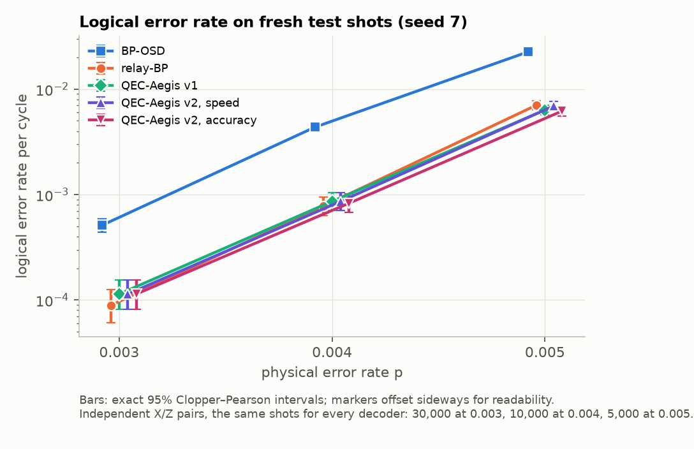
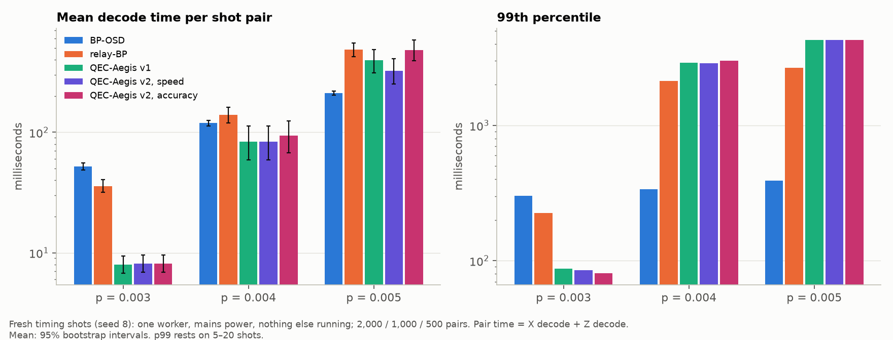
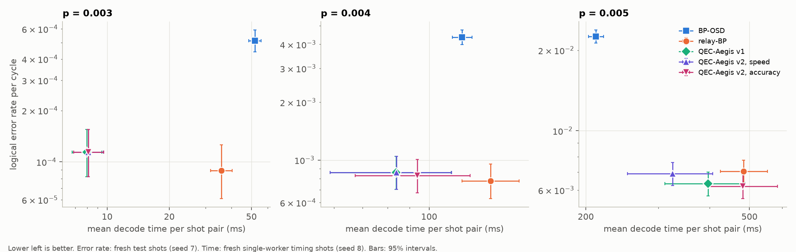
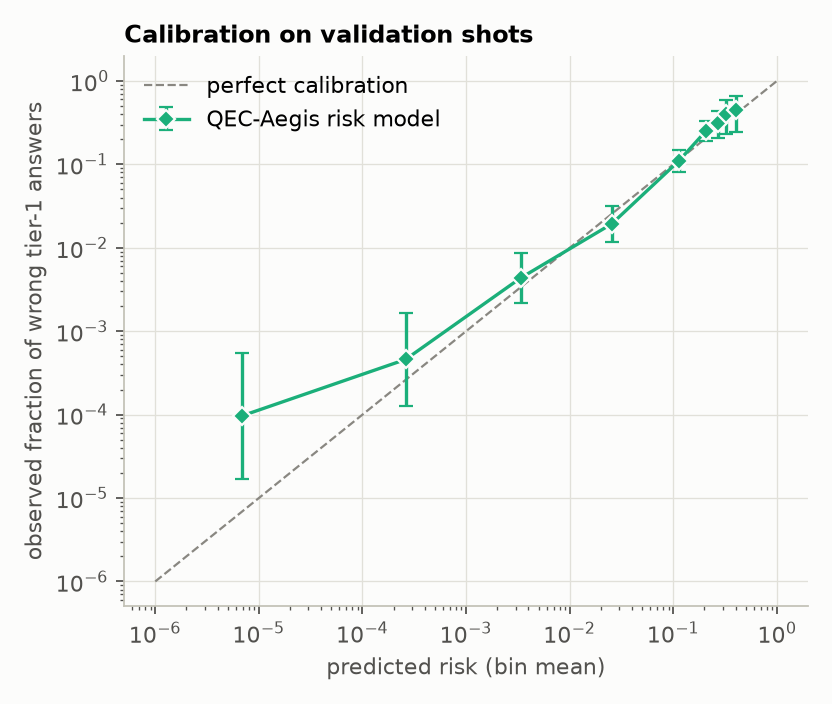
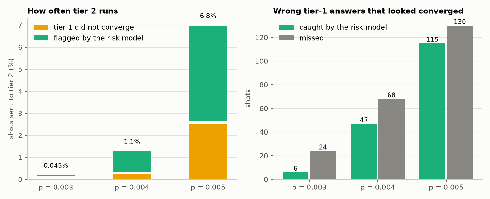

# QEC-Aegis: learned risk routing for fast, accurate Gross-code decoding

**Infleqtion Challenge 1: ML-assisted QEC decoding** · MidQWest 2026 · [Challenge brief](CHALLENGE.md)

QEC-Aegis decodes the [[144,12,12]] Gross code with a fast decoder on every shot and a machine-learned risk model that sends only the doubtful shots to the slow, accurate one. On fresh test data it is **1.5–4.5× faster than relay-BP on average with no significant loss of accuracy**, and at p = 0.005 it is **significantly more accurate** than relay-BP.

> **Reviewing in five minutes?**
> 1. [The idea](#the-idea-in-30-seconds): 30 seconds.
> 2. [Results](#results): a table and three plots.
> 3. [`aegis/decoder.py`](aegis/decoder.py): the whole decoder in 69 lines.
> 4. [Run the demo](#quickstart): one command.
> 5. [`docs/ARCHITECTURE.md`](docs/ARCHITECTURE.md): how everything fits, from first principles to code.
> 6. [`docs/PRESENTATION.md`](docs/PRESENTATION.md): the five-slide talk.

## The idea in 30 seconds
Most shots are easy: a short relay-BP run converges to the right correction. The costly mistake is the rare shot where it **converges to a wrong answer**, which no convergence check can see. QEC-Aegis reads 28 features of the fast run (syndrome, iterations, posterior margins, a cheap second opinion) and predicts a **calibrated probability that the answer is wrong**. Only shots above a threshold, chosen on validation data, go to full relay-BP.

```
syndrome ─► tier 1: fast relay-BP ─► 28 features ─► risk model ─┬─► accept the answer        (most shots)
                                                                └─► tier 2: full relay-BP     (risky shots)
```

## Results
Same fresh shots for every decoder (seed 7: 30,000 / 10,000 / 5,000 independent X/Z pairs). Latency from separate single-worker timing shots (seed 8). Each cell: failed pairs · mean time per pair.

| p | BP-OSD | relay-BP | QEC-Aegis v1 | QEC-Aegis v2, speed | QEC-Aegis v2, accuracy |
|---|---|---|---|---|---|
| 0.003 | 184 · 52 ms | 32 · 36 ms | 41 · **8.0 ms** | 41 · 8.1 ms | 41 · 8.1 ms |
| 0.004 | 511 · 119 ms | 93 · 139 ms | 103 · **84 ms** | 103 · 84 ms | 99 · 94 ms |
| 0.005 | 1,196 · 212 ms | 407 · 484 ms | 367 · 397 ms | 399 · **325 ms** | **359** · 482 ms |

**Where it works**
- **Faster than relay-BP at equal accuracy:** 4.5× (p = 0.003) and 1.7× (p = 0.004) on average with v1, and 1.5× at p = 0.005 with v2 speed mode. No difference in failures is statistically significant (McNemar p ≥ 0.17).
- **More accurate where noise is highest:** at p = 0.005, v2 accuracy mode fails on 359 pairs vs relay-BP's 407 (LER ratio 0.88, McNemar p = 0.002) at the same mean time.
- **Far ahead of BP-OSD:** 3–5× fewer failed pairs at every p (McNemar p < 1e-26).

**Where it falls short**
- **Tail latency:** the slowest 1% of shots are slower than relay-BP (p99 4.3 vs 2.7 s at p = 0.005), because escalated shots pay for both tiers.
- **Missed wrong answers:** some still get through; the demo below shows one.
- **Implementation:** pure Python on a laptop CPU, far from real-time budgets.

All limitations: [`docs/EVALUATION.md`](docs/EVALUATION.md#where-it-works-and-where-it-falls-short).

<p align="center">
  
</p>




**Why the machine learning works.**
- **Calibrated (left):** the model's predicted risk matches how often tier 1 is really wrong, so one threshold works at every noise level.
- **Selective (right):** only 0.045–6.8% of shots go to tier 2. Many of the converged-but-wrong answers that a convergence check cannot see are caught; the rest are the headroom.

<p align="center">
  
  
</p>

**All 13 figures**, each with how to read it, are in [`docs/FIGURES.md`](docs/FIGURES.md).

## Quickstart
Tested with Python 3.13. `relay-bp` builds with Rust ([rustup.rs](https://rustup.rs)).

```bash
python3 -m venv .venv
.venv/bin/pip install -r challenge-1-ml-decoder-kit/requirements-dev.txt
ln -s ../.venv challenge-1-ml-decoder-kit/.venv          # the kit's scripts expect their own .venv

.venv/bin/python -m aegis.demo --p 0.005 --shots 15     # live demo: fresh shots, QEC-Aegis vs relay-BP
scripts/reproduce.sh                                    # full check: tests, model hashes, records, results, plots
```

Demo output (abridged):
```
shot alarms       tier 1     risk tier 2  Aegis ms relay-BP ms  correct (Aegis / relay-BP)
   1    174    converged  6.6e-05     no       2.5        25.7  yes / yes
   8    165    converged  6.3e-02     no      73.7       157.0  yes / yes
  14    175    converged  1.5e-01     no      66.9       215.3  NO / yes
15 shots: QEC-Aegis 14 correct, mean 100.9 ms; relay-BP 15 correct, mean 197.5 ms (2.0x).
```
Shot 14 is the failure mode in miniature. Tier 1 converged to a wrong answer, and the model rated its risk 0.15, below the 0.288 threshold, so it was not escalated.

## Challenge deliverables

| The brief asks for | Where it is |
|---|---|
| A working decoder | [`aegis/decoder.py`](aegis/decoder.py), with frozen models in [`models/`](models/) (v1) and [`models/v2/`](models/v2/) |
| Code that generates training and test data | [`aegis/collect.py`](aegis/collect.py): samples the kit's circuits and stores per-shot records for every decoder. [`aegis/train.py`](aegis/train.py) and [`aegis/retune.py`](aegis/retune.py) fit and select the model |
| A script that reproduces the evaluation | [`scripts/reproduce.sh`](scripts/reproduce.sh): checks everything from the committed data. [`scripts/run_fresh_evaluation.sh`](scripts/run_fresh_evaluation.sh): decodes the fresh shots again from scratch |
| Comparison with the baselines, with a plot | [Results](#results) above; every table in [`docs/RESULTS.md`](docs/RESULTS.md); numbers in [`v2_summary.csv`](experiments/reports/v2_summary.csv) |
| A short presentation or demo | [`docs/PRESENTATION.md`](docs/PRESENTATION.md) and `python -m aegis.demo` |

## Repository layout
```
aegis/                       QEC-Aegis package
  decoder.py                   the routed decoder: tier 1 → risk → tier 2
  tiers.py  features.py        decoders behind one interface; the 28 risk features
  model.py                     risk model, calibration, compiled tree walk
  collect.py                   data generation: decode fixed shots, store per-shot records
  train.py  retune.py          model selection (v1) and per-setting operating points (v2)
  evaluate.py  evaluate_v2.py  evaluation against BP-OSD and relay-BP
  report.py  figures.py        generate docs/RESULTS.md and docs/figures/
  demo.py                      live demo
models/                      frozen risk models (hashes in experiments/reports/*frozen*.json)
experiments/
  records/                     per-shot records of every decoder (validation, test, timing)
  reports/                     evaluations, selections, frozen hashes, v2_summary.csv
  manifest.json                provenance of every decoding run
scripts/
  reproduce.sh                 one-command verification of every result
  run_fresh_evaluation.sh      decode the fresh test and timing shots from scratch
tests/                       QEC-Aegis tests (55)
docs/                        architecture, results, figures, evaluation, presentation, erasure study
challenge-1-ml-decoder-kit/  the challenge kit, the erasure study and the team's baselines
```

## Documentation

| Page | What it covers |
|---|---|
| [`docs/ARCHITECTURE.md`](docs/ARCHITECTURE.md) | The idea from first principles, a code tour in reading order, and the data flow |
| [`docs/RESULTS.md`](docs/RESULTS.md) | Every result table, generated from the stored evaluation |
| [`docs/FIGURES.md`](docs/FIGURES.md) | Every plot, with what it shows and how to read it |
| [`docs/EVALUATION.md`](docs/EVALUATION.md) | Full discussion: v1 and v2, where it works and falls short, data and seeds |
| [`docs/PRESENTATION.md`](docs/PRESENTATION.md) | The five-slide talk |
| [`docs/ERASURE.md`](docs/ERASURE.md) | Companion study: decoding with erasure (loss) flags, the hybrid decoder and the ML router |
| [`docs/AUDIT.md`](docs/AUDIT.md) | Evidence checks for the erasure study |

## How the numbers were obtained
- **Data splits:** the model is trained on seed-1 shots, calibrated on seed-4 shots, and its thresholds are chosen on seed-3 validation shots.
- **Frozen before testing:** model files are hashed before any test shot is decoded (v1: seed 2; v2: fresh seeds 7 and 8).
- **Fair comparisons:** every decoder decodes identical shots and is scored on the same independent X/Z pairs, with exact intervals and paired McNemar tests.
- **Timing:** latency is measured on one worker with nothing else running.

Details: [`docs/ARCHITECTURE.md`](docs/ARCHITECTURE.md#4-the-scientific-protocol).

## Companion study: erasure flags
On neutral-atom hardware, some errors can be heralded as erasures with a known location. Giving those flags to relay-BP on the same shots (50% of noise flagged) cuts failed pairs from **41 to 2** at p = 0.004 and from **138 to 6** at p = 0.005. Decoding also becomes 2–5× faster on average. Flags are idealized: instant and exact. Full study, the hybrid decoder and an honest negative result for a convergence router: [`docs/ERASURE.md`](docs/ERASURE.md).
