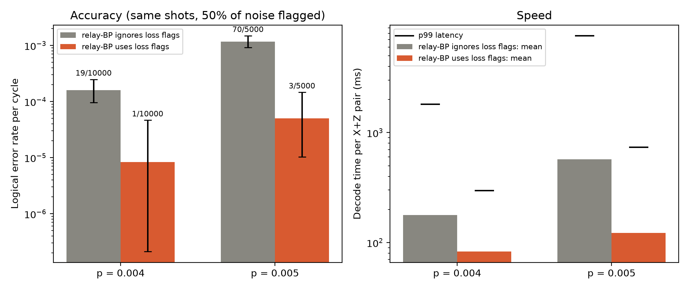

# MGC: erasure-aware decoding of the Gross code

Infleqtion Challenge 1 (ML-assisted QEC decoding), MidQWest 2026. See [AUDIT.md](AUDIT.md) for the submission readiness checks. The challenge brief is in [CHALLENGE.md](CHALLENGE.md).

**Question:** on neutral-atom hardware, some errors can be converted into *erasures* that come with a flag saying where they happened (idealized heralded erasure conversion; real atom loss is detected later, see limits). How much does a decoder gain on the [[144,12,12]] Gross code by using those flags, and can ML cut decoding time without losing accuracy?

## Results

### 1. Using erasure flags (headline)
**relay-BP, the strongest decoder in the kit, with the loss flags.** relay-BP has no per-shot prior update, so it is rebuilt for every shot (about 17 ms, included in its time) on the flag-blind matrix, with each flagged location's error probability raised (`lossy.fold_priors`, combining identical effects by parity). 50% of gate/idle noise flagged as erasure; the same shots are decoded with flags ignored and with flags used.

| p | Pairs | Flags ignored: failed pairs (rate/cycle) | Flags used | Failed only ignored / only used | Exact McNemar p | Mean time ignored → used | p99 latency ignored → used |
|---|---|---|---|---|---|---|---|
| 0.004 | 10,000 | 19 (1.6e-4) | **1** (8.3e-6) | 19 / 1 | 4e-5 | 177 → **83 ms** | 1,817 → **296 ms** |
| 0.005 | 5,000 | 70 (1.2e-3) | **3** (5.0e-5) | 68 / 1 | 2e-19 | 571 → **122 ms** | 7,599 → **738 ms** |

Roughly 20× fewer failed pairs, 2–5× faster on average and 6–10× lower p99 latency. The counts are small (1 and 3 failures with flags), so read the accuracy gain as "over 10× fewer", not as a precise ratio. Timing was measured on one Apple laptop, 11 worker processes, both decoders on the same shots under the same load; read it as a ratio, not a latency guarantee. Seeds 32 and 33 (p = 0.004) and 31 (p = 0.005); files `results/erase4_*`. Pair counts are half the shots per basis; see *Pairing* below.



**BP-OSD with the loss flags** (the first experiment; the flags enter BP-OSD's priors through its per-shot update):
These results include the corrected herald-conditioned prior calculation (see [AUDIT.md](AUDIT.md)); the erasure runs were regenerated locally after the fix.
p = 0.004, 12 syndrome cycles, X and Z memory. The same simulated shots are decoded with flags hidden and with flags visible. Rates are logical errors per cycle with exact (Clopper-Pearson) 95% intervals.

| Noise flagged as erasure | Flags hidden (BP-OSD) | Flags used (BP-OSD) | Pairs |
|---|---|---|---|
| 0% | 4.6e-3 [3.0–6.7e-3] (27) | 4.6e-3 (identical, as expected) | 500 |
| 25% | 1.3e-3 [0.6–2.6e-3] (8) | 6.7e-4 [1.8–17e-4] (4) | 500 |
| 50% | 6.7e-4 [2.9–13e-4] (8) | 1.7e-4 [0.2–6.0e-4] (2) | 1,000 |
| 75% | 3.3e-4 [0.9–8.5e-4] (4) | < 3.1e-4 (0 failures seen) | 1,000 |

**Paired test on identical shots** (pairs where only one of the two decoders failed; exact McNemar test):

| Noise flagged | Failed only with flags hidden | Failed only with flags used | p-value |
|---|---|---|---|
| 25% | 6 | 2 | 0.29 (not significant) |
| 50% | 6 | 0 | 0.031 |
| 75% | 4 | 0 | 0.125 (not significant) |

For BP-OSD the flags never caused a failure at 50% or 75% that the flag-blind decoder avoided, and fewer pairs failed at every nonzero share, but with these sample sizes only the 50% result is significant (p = 0.03), and the size of the gain is poorly determined. The relay-BP experiment above, with 5–10× more shots, is the strong evidence that flags help.

**Scope:** this table is BP-OSD only; the relay-BP result above uses a different flag mechanism (rebuild per shot on the blind matrix) and needs no extra columns. The 0% row (4.3e-3 on 1,000 pairs) and the sweep's BP-OSD at p = 0.004 (4.3e-3 on 2,000 different pairs) agree.


- **Cost:** flag-aware BP-OSD is about 6.7× slower per shot at 50% erasure (about 8–9× at 25% and 75%), because the decoder considers each erasure component separately and its priors are updated every shot.
- **Why the flag-blind line also falls:** an erasure applies a random Pauli, and a quarter of those are the identity, so converting noise to erasure also lowers the effective error rate. The fair comparison is therefore flags hidden vs used **at the same erasure share, on the same shots**.

### 2. Required sweep: baselines and hybrid decoders
Logical error rate per cycle (95% CI) and failed pairs, same test shots for every decoder:

*Pairing:* the saved X and Z runs share a seed, so X shot k and Z shot k come from the same Stim random stream and are correlated. A shuffle alone does not fix this: it moves correlated shots into neighbouring pairs, so pairs are no longer independent and exact intervals and tests would be invalid. `analyze.independent_pairs` therefore takes X shots from one fixed random half of the indices and Z shots from the other half, so every index appears in at most one pair and pairs are independent. The price is that each comparison uses half the shots per basis. Every decoder uses the same pairs. New runs (`run_job.py`, seed scheme `ss-v1`) derive independent X and Z sampler seeds and are paired row by row using every shot.

| p | relay-BP | BP-OSD | Hybrid (rule) | Hybrid (ML router) | Kit reference (relay / BP-OSD) |
|---|---|---|---|---|---|
| 0.003 | 3.3e-5 (1/2,500) | 2.3e-4 (7/2,500) | 3.3e-5 (1/2,500) | 3.3e-5 (1/2,500) | 4.2e-5 / 4.7e-4 |
| 0.004 | 5.9e-4 (7/1,000) | 4.1e-3 (48/1,000) | 5.9e-4 (7/1,000) | 5.9e-4 (7/1,000) | 8.7e-4 / 4.4e-3 |
| 0.005 | 6.9e-3 (80/1,000) | 2.5e-2 (261/1,000) | 6.9e-3 (80/1,000) | 6.9e-3 (80/1,000) | 6.9e-3 / 2.3e-2 |

Both hybrids have the same observed failed-pair count as relay-BP at all three tested noise levels; this finite sample does not prove equal underlying error rates. The hybrid is close to relay-BP with an early exit: relay-BP's first leg is BP, and the kit keeps running relay legs until 5 solutions have been found (`stop_nconv=5`) and returns the best of them, while the hybrid accepts BP's first converged answer.

**Decode time** (one idle laptop, 1 thread, 150 independent X+Z pairs per p):

| p | relay-BP mean / p99 | Hybrid (rule) mean / p99 | Hybrid (ML) mean | Shots escalated (rule) |
|---|---|---|---|---|
| 0.003 | 92 / 366 ms | **55** / 393 ms | 57 ms | 5% |
| 0.004 | 557 / 7,303 ms | 475 / 7,263 ms | 474 ms | 23% |
| 0.005 | 2,086 / 10,276 ms | 2,081 / 10,425 ms | 2,092 ms | 56% |


**Additional local comparison with both baselines:** Apple M5, 150 independent pairs per p, one worker/thread, under concurrent load. Entries are mean / p99 milliseconds per X+Z pair. Every decoder uses the same shots within this run. These are measured comparisons, not idle-machine latency guarantees.

| p | BP-OSD | relay-BP | Hybrid rule | Hybrid ML |
|---|---:|---:|---:|---:|
| 0.003 | 100 / 543 | 67 / 618 | 48 / 651 | 48 / 652 |
| 0.004 | 298 / 830 | 245 / 3171 | 229 / 3210 | 232 / 3211 |
| 0.005 | 503 / 966 | 1264 / 8263 | 1252 / 8377 | 1256 / 8265 |


### 3. The ML router (an honest negative result)
A gradient-boosted classifier reads the alarms per round and predicts whether fast BP will converge, so hard shots can skip it. (It also has a loss-flag-count input, but the sweep has no erasure, so that input is always 0.) Accuracy on held-out shots:

| p | ML router | One alarm-count threshold | Always guess the majority |
|---|---|---|---|
| 0.003 | 0.929 | 0.929 | 0.929 |
| 0.004 | 0.757 | 0.773 | 0.775 |
| 0.005 | 0.597 | 0.614 | 0.530 |

The router does not beat a single threshold. BP's own convergence check is already a good router: across all 14,166 test shots where fast BP converged, it was wrong on only 2 (both at p = 0.005).

**Upper bound for any router** (from the clean timing cache): even a *perfect* router, which skips BP exactly on the shots where it won't converge, would cut the hybrid's mean time by only 16.5% at p = 0.003, 7.8% at p = 0.004 and 3.7% at p = 0.005. Routing on convergence has little to gain. Learning would be better spent elsewhere, for example on per-shot priors.

## Where it works and where it falls short
- **Works:** with relay-BP, using erasure flags gives a large, statistically significant accuracy gain (p ≤ 4e-5 at both noise levels) and makes decoding 2–5× faster on average with 6–10× lower p99 latency. With BP-OSD the flags also reduce failures, but only the 50% share is significant on our sample sizes. The simple convergence hybrid keeps relay-BP accuracy and is ~1.7× faster on average at low noise (p = 0.003).
- **Falls short:**
  - Convergence hybrid: p99 latency does not improve, and there is no speedup at p = 0.005. (Both refer to the hybrid, not to flag-aware relay-BP, which is faster on both counts.)
  - Flag-aware *BP-OSD* costs several times more decode time than flag-blind BP-OSD (flag-aware relay-BP is faster, not slower).
  - The ML router does not outperform the simple convergence rule.
  - Error bars are wide wherever failures are few: p = 0.003, the BP-OSD erasure table, and the flag-aware relay counts (1 and 3).
- **Model limits:** erasures are *idealized*. Flags fire instantly at the gate with the exact location, and the qubit returns to the code space. Real atom loss is detected later and a lost atom keeps causing errors. Preparation and measurement errors are not converted. The DEM/decoder also approximates correlations between disjoint Pauli outcomes; corrected conditional marginals do not make it an exact joint decoder.

## Method
- **Code and noise:** the kit's Gross-code memory circuits (Bravyi et al.; the relay-BP paper's error model). In `lossy.py`, each depolarizing channel of strength p becomes `DEPOLARIZE((1−f)p)` plus `HERALDED_ERASE`, with probability f·p per qubit for one-qubit channels and f·p/2 per qubit for two-qubit channels, so the expected number of fault events per gate stays about p. Each herald is recorded as a detector (coordinate 2).
- **Flag-aware priors:** erasure components keep their own decoder columns. Pauli multiplicities are recovered from the DEM probability divided by the herald-event probability, including outcomes Stim has already merged. Mutually exclusive outcomes sharing a herald are summed. Per shot, a column whose herald fired gets prior (merged Pauli components) × 1/4, e.g. 0.5 when two components look identical to the checks. Unfired erasure columns get 1e-9. The prior update is counted as decode time.
- **Hybrid:** min-sum BP (200 iterations). If it converges, its answer is accepted. Otherwise relay-BP runs, at the kit's settings.
- **Router:** scikit-learn `HistGradientBoostingClassifier`, trained on seed-1 shots and tested on seed-2 shots.
- **Scoring:** the kit's rule. An X/Z shot pair fails if either basis fails, and per-cycle rate = 1 − (1 − P)^(1/12).

## Resources
From the audited local `python demo.py` runs on an Apple M5 (10 logical cores, numerical libraries limited to one thread):
- Decoding problem: 936 checks × 8,784 error mechanisms.
- Router model: 718 kB.
- Peak memory: 191–196 MB for the whole demo process, including imports and router training.
- Decoder setup: ~0.02–0.03 s. Both fresh X/Z seed-99 demos decoded correctly. The demo is a demonstration, not a pass/fail check (a correct decoder can fail on a noisy shot); the asserted live checks are the real fast-BP, relay-BP and fallback tests in `test_submission.py`.

The flag-aware matrix is larger (936 × ~32,000 columns). Benchmarks used 7–8 worker processes per laptop on 8–12-core laptops. The historical timing table used 1 thread and lacks BP-OSD. The new local timing sweep includes BP-OSD, relay-BP and both hybrids on matching shots; it is explicitly labeled as a concurrent-load run.

## Reproduce
```bash
cd challenge-1-ml-decoder-kit
python3 -m venv .venv && source .venv/bin/activate
pip install -r requirements-dev.txt      # relay-bp needs Rust (rustup.rs)
python run_job.py --basis X --p 0.004 --shots 2000 --seed 2 --decoders bp relay bposd --out results_new/test_X_p0.004.npz   # independent X/Z streams (seed scheme ss-v1)
# Full fresh-data commands are in challenge-1-ml-decoder-kit/RUN.md
bash scripts/verify_submission.sh                            # tests, audit, evaluation, demos
python analyze.py --dir results                               # tables and results/results.png (all experiments)
python analyze.py --dir results_timing --train-dir results    # clean timing table
python make_figures.py                                        # figures/erasure.png, relay_flags.png, speed.png
python demo.py --p 0.004 --basis X                            # one fresh shot through router and decoder, plus resources
```
- Saved result caches are in the repo. `analyze.py` reproduces accuracy counts without rerunning the decoders; router timings are newly measured and naturally vary. See [RUN.md](challenge-1-ml-decoder-kit/RUN.md) for full regeneration commands and package versions.
- **Seeds are not portable across Stim builds:** the same seed can give different shots on another machine. That is why every comparison is made within one results file (all decoders on identical shots), and why `analyze.py` checks metadata, per-round weights and flags before merging extras. Legacy caches lack full sample fingerprints, so this compatibility check is not a proof of shot identity. New runs also record a detector/observable SHA-256, the circuit SHA-256, split, seed scheme, derived sampler seed and runtime provenance.

## Files
| File | What it does |
|---|---|
| `lossy.py` | Heralded-erasure circuits; flag-blind and flag-aware decoding matrices; per-shot priors |
| `run_job.py` | Decodes a batch of shots once with the chosen decoders and caches every answer, time and convergence flag |
| `analyze.py` | Trains the router, builds the hybrids from the cache, reports exact CIs, writes tables and plots |
| `make_figures.py` | Presentation figures |
| `demo.py`, `hybrid.py` | Shared trained router and live decoding interface; resource report |
| `audit_submission.py`, `scripts/verify_submission.sh` | Repeatable data checks, tests, evaluation and live demos |
| `AUDIT.md`, `PITCH.md`, `challenge-1-ml-decoder-kit/RUN.md` | Current evidence, presentation, and reproduction guide |
| `docs/history/` | Historical planning notes and agent prompts; superseded by the audit |
