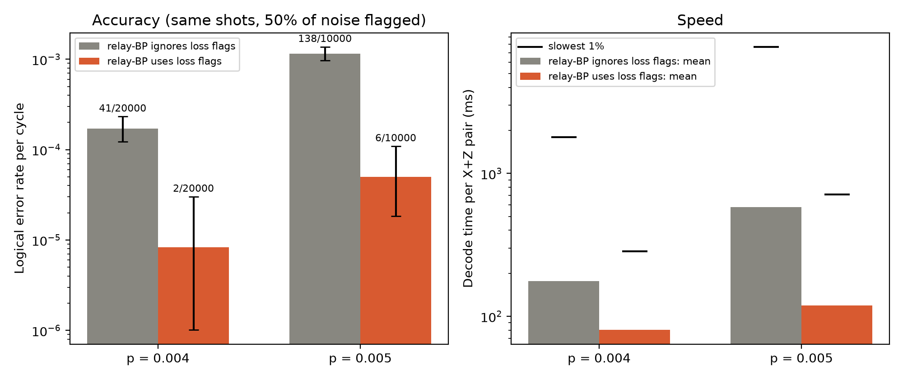
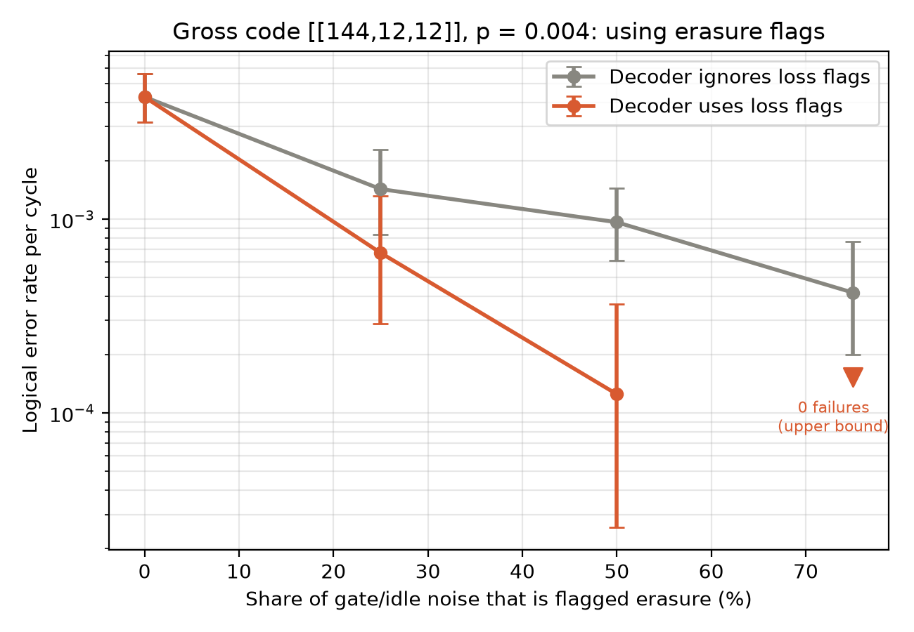
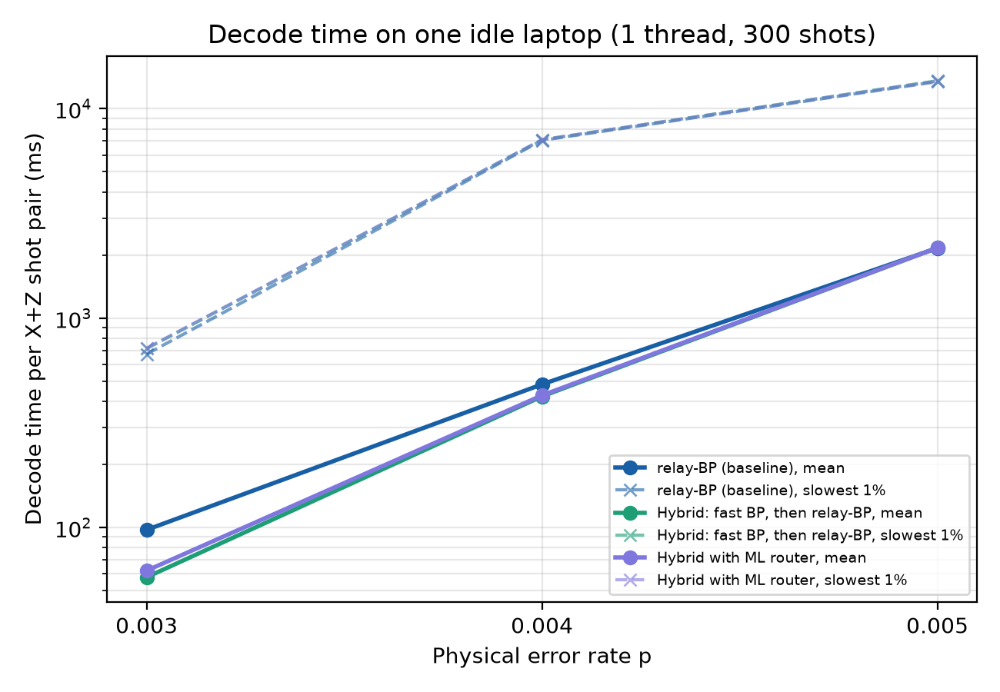
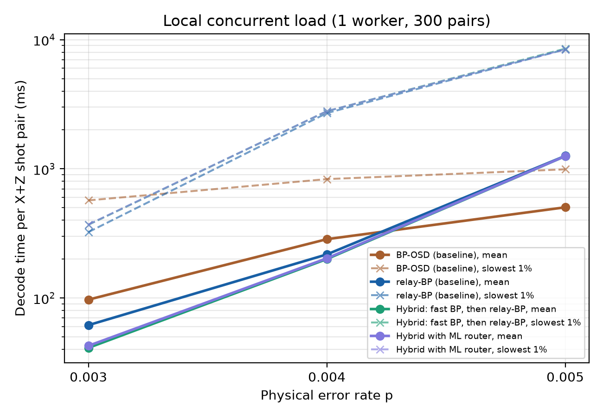

# Erasure-aware decoding: using loss flags on the Gross code

This is the first study in this repository, built on the challenge kit in `challenge-1-ml-decoder-kit/`. It asks how much a decoder gains on the [[144,12,12]] Gross code when some noise is converted into heralded erasures whose location is flagged, and whether a learned router can cut decoding time. The learned decoder that came out of it, QEC-Aegis, is described in [docs/RESULTS.md](../docs/RESULTS.md). Evidence checks for this study are in [AUDIT.md](AUDIT.md).

## 1. Using erasure flags (headline)
**relay-BP, the strongest decoder in the kit, with the loss flags.** relay-BP has no per-shot prior update, so it is rebuilt for every shot (about 17 ms, included in its time) on the flag-blind matrix, with each flagged location's error probability raised (`lossy.fold_priors`, combining identical effects by parity). 50% of gate/idle noise flagged as erasure; the same shots are decoded with flags ignored and with flags used.

| p | Pairs | Flags ignored: failed pairs (rate/cycle) | Flags used | Failed only ignored / only used | Exact McNemar p | Mean time ignored → used | Slowest 1% ignored → used |
|---|---|---|---|---|---|---|---|
| 0.004 | 20,000 | 41 (1.7e-4) | **2** (8.3e-6) | 41 / 2 | 2e-10 | 176 → **80 ms** | 1,796 → **286 ms** |
| 0.005 | 10,000 | 138 (1.2e-3) | **6** (5.0e-5) | 134 / 2 | 2e-37 | 581 → **119 ms** | 7,677 → **711 ms** |

Roughly 20× fewer failed pairs, 2–5× faster on average and 6–11× faster on the slowest 1%. Timing was measured on one Apple laptop, 11 worker processes, both decoders on the same shots under the same load; read it as a ratio, not a latency guarantee. The ~20× is a ratio of small counts: the conservative reading is "over 10× fewer". Seeds 32 and 33 (p = 0.004) and 31 (p = 0.005); files `results/erase4_*`.



**BP-OSD with the loss flags** (the first experiment; the flags enter BP-OSD's priors through its per-shot update):
These results include the corrected herald-conditioned prior calculation (see [AUDIT.md](AUDIT.md)); the erasure runs were regenerated locally after the fix.
p = 0.004, 12 syndrome cycles, X and Z memory. The same simulated shots are decoded with flags hidden and with flags visible. Rates are logical errors per cycle with exact (Clopper-Pearson) 95% intervals.

| Noise flagged as erasure | Flags hidden (BP-OSD) | Flags used (BP-OSD) | Gain | Pairs |
|---|---|---|---|---|
| 0% | 4.3e-3 [3.2–5.6e-3] | 4.3e-3 (identical, as expected) | — | 1,000 |
| 25% | 1.4e-3 [0.8–2.3e-3] | 6.7e-4 [2.9–13e-4] | ~2× | 1,000 |
| 50% | 9.6e-4 [6.1–14e-4] | 1.3e-4 [0.3–3.7e-4] | **~7.7×** | 2,000 |
| 75% | 4.2e-4 [2.0–7.7e-4] | < 1.5e-4 (0 failures seen) | no failures to count | 2,000 |

**Paired test on identical shots** (pairs where only one of the two decoders failed; exact McNemar test):

| Noise flagged | Failed only with flags hidden | Failed only with flags used | p-value |
|---|---|---|---|
| 25% | 15 | 6 | 0.078 (not significant) |
| 50% | 20 | 0 | 1.9e-6 |
| 75% | 10 | 0 | 0.002 |

At 50%, 23 pairs failed with flags hidden versus 3 with flags used. At 50% and 75%, using the flags never caused a failure that the flag-blind decoder avoided; at 25%, 6 pairs failed only with flags (the 25% result is not significant). The "~7.7×" is the ratio of those counts, and its uncertainty is wide (the 95% intervals in the table above), so read it as "several times fewer".

**Scope:** this table is BP-OSD only; the relay-BP result above uses a different flag mechanism (rebuild per shot on the blind matrix) and needs no extra columns. The 0% row (4.3e-3 on 1,000 pairs) and the sweep's BP-OSD at p = 0.004 (4.3e-3 on 2,000 different pairs) agree.



- **Cost:** flag-aware BP-OSD is about 6.5× slower per shot at 50% erasure (about 9–10× at 25% and 75%), because the decoder considers each erasure component separately and its priors are updated every shot.
- **Why the flag-blind line also falls:** an erasure applies a random Pauli, and a quarter of those are the identity, so converting noise to erasure also lowers the effective error rate. The fair comparison is therefore flags hidden vs used **at the same erasure share, on the same shots**.

### 1b. Robustness: imperfect loss flags (relay-BP)

Real hardware does not hand the decoder perfect flags. Infleqtion's answer to our question: the exact gate of a loss cannot be pinned down (loss is most likely after a CZ), but state-selective readout of the check (ancilla) qubits can report 0 / 1 / lost every syndrome round. So we degraded the flags and re-decoded **the same 10,000 shot pairs** (p = 0.004, 50% of noise flagged, seed 32; every file's sample hash matches the flag-blind run):

| Flags given to relay-BP | Failed pairs | Failed only with flags ignored / only with these flags | Exact McNemar p |
|---|---:|---:|---:|
| Ignored (flag-blind relay-BP) | 18 | | |
| Perfect | 1 | 18 / 1 | 8e-5 |
| 10% of real flags missed | 2 | 17 / 1 | 1e-4 |
| 30% of real flags missed | 4 | 16 / 2 | 0.001 |
| ~30% extra false flags (each unflagged location fires with prob. 3.5e-4) | 2 | 18 / 2 | 4e-4 |
| Right qubit, timing unknown within ~1 round (7 consecutive erasure opportunities) | 3 | 15 / 0 | 6e-5 |
| Right qubit, timing unknown within ~3 rounds (21 opportunities) | 3 | 15 / 0 | 6e-5 |

Knowing *which atom* carries most of the benefit; knowing exactly *when* adds little. With an uncertain window, the flagged probability is spread evenly over the window (`lossy.timing_window_flags`).

**Loss sweep** (relay-BP, flags ignored vs used, same shots, p = 0.004, 10,000 pairs each, seed 32):

| Loss share f | Failed pairs ignored → used | McNemar p | Slowest 1% per pair |
|---|---|---:|---|
| 25% | 41 → 18 | 3e-4 | 3.6 s → 1.2 s |
| 50% | 18 → 1 | 8e-5 | 2.0 s → 0.34 s |
| 75% | 11 → 8 | 0.65 (not significant) | 0.32 s → 0.05 s |

At 75% too few failures remain to resolve an accuracy difference (part of each erasure is the identity, so total damage falls as f grows); the speed gain remains.

**Not modeled:** a lost atom stays lost until it is replaced, so every later gate on it does nothing and errors spread over several rounds ("gate-removing" loss, as in Liu et al., *Achieving Optimal-Distance Atom-Loss Correction via Pauli Envelope*, arXiv:2603.04156). Our erasure is a single randomizing error at one location, so these results are an optimistic but robustness-checked first step.

Reproduce (`challenge-1-ml-decoder-kit/`):
```bash
python run_job.py --basis X --p 0.004 --f 0.5 --shots 10000 --seed 32 --decoders relay relay_flags --out results/erase4_X_p0.004_f0.5_s32.npz
python run_job.py --basis X --p 0.004 --f 0.5 --shots 10000 --seed 32 --decoders relay_flags --flag-miss 0.3 --out results/flagnoise_X_p0.004_f0.5_s32_miss0.3_false0.npz
python run_job.py --basis X --p 0.004 --f 0.5 --shots 10000 --seed 32 --decoders relay_flags --flag-false 0.00035 --out results/flagnoise_X_p0.004_f0.5_s32_miss0_false0.00035.npz
python run_job.py --basis X --p 0.004 --f 0.5 --shots 10000 --seed 32 --decoders relay_flags --flag-window 7 --out results/flagnoise_X_p0.004_f0.5_s32_window7.npz
# same with --basis Z; f = 0.25 / 0.75 as erase4_*_f0.25/0.75_s32.npz. Pairing: analyze.pair_arrays (fixed random X/Z derangement).
```
Shots are only identical to the flag-blind run on the same Stim build; check `sample_sha256` before pairing records from different machines.

## 2. Required sweep: baselines and hybrid decoders
Logical error rate per cycle (95% CI) and failed pairs, same test shots for every decoder:

*Pairing:* X and Z runs that share a seed get the same Stim random stream, so their shots are correlated. Each X shot is therefore paired with a different, fixed random Z shot (`analyze.z_partner`), which makes the two halves of a pair independent, as in the kit's baseline. Every decoder uses the same pairs.

| p | relay-BP | BP-OSD | Hybrid (rule) | Hybrid (ML router) | Kit reference (relay / BP-OSD) |
|---|---|---|---|---|---|
| 0.003 | 3.3e-5 (2/5,000) | 3.2e-4 (19/5,000) | 3.3e-5 (2/5,000) | 3.3e-5 (2/5,000) | 4.2e-5 / 4.7e-4 |
| 0.004 | 6.3e-4 (15/2,000) | 4.3e-3 (100/2,000) | 6.3e-4 (15/2,000) | 6.3e-4 (15/2,000) | 8.7e-4 / 4.4e-3 |
| 0.005 | 6.8e-3 (158/2,000) | 2.3e-2 (492/2,000) | 6.8e-3 (158/2,000) | 6.8e-3 (158/2,000) | 6.9e-3 / 2.3e-2 |

Both hybrids have the same observed failed-pair count as relay-BP at all three tested noise levels; this finite sample does not prove equal underlying error rates. The hybrid is close to relay-BP with an early exit: relay-BP's first leg is BP, and the kit keeps running relay legs until 5 solutions have been found (`stop_nconv=5`) and returns the best of them, while the hybrid accepts BP's first converged answer.

**Decode time** (one idle laptop, 1 thread, 300 X+Z pairs per p):

| p | relay-BP mean / slowest 1% | Hybrid (rule) mean / slowest 1% | Hybrid (ML) mean | Shots escalated (rule) |
|---|---|---|---|---|
| 0.003 | 97 / 487 ms | **58** / 529 ms | 61 ms | 5% |
| 0.004 | 482 / 7,200 ms | 422 / 7,134 ms | 425 ms | 23% |
| 0.005 | 2,155 / 10,568 ms | 2,165 / 10,712 ms | 2,163 ms | 56% |




**Additional local comparison with both baselines:** Apple M5, 300 pairs per p, one worker/thread, under concurrent load. Entries are mean / p99 milliseconds per X+Z pair. Every decoder uses the same shots within this run. These are measured comparisons, not idle-machine latency guarantees.

| p | BP-OSD | relay-BP | Hybrid rule | Hybrid ML |
|---|---:|---:|---:|---:|
| 0.003 | 97 / 572 | 62 / 329 | 41 / 355 | 44 / 357 |
| 0.004 | 285 / 819 | 217 / 2604 | 200 / 2635 | 204 / 2638 |
| 0.005 | 503 / 970 | 1259 / 6954 | 1253 / 7063 | 1256 / 6958 |



## 3. The ML router (an honest negative result)
A gradient-boosted classifier reads the alarms per round and predicts whether fast BP will converge, so hard shots can skip it. (It also has a loss-flag-count input, but the sweep has no erasure, so that input is always 0.) Accuracy on held-out shots:

| p | ML router | One alarm-count threshold | Always guess the majority |
|---|---|---|---|
| 0.003 | 0.929 | 0.929 | 0.929 |
| 0.004 | 0.757 | 0.773 | 0.775 |
| 0.005 | 0.597 | 0.614 | 0.530 |

The router does not beat a single threshold. BP's own convergence check is already a good router: across all 14,166 test shots where fast BP converged, it was wrong on only 2 (both at p = 0.005).

**Upper bound for any router** (from the clean timing cache): even a *perfect* router, which skips BP exactly on the shots where it won't converge, would cut the hybrid's mean time by only 16.5% at p = 0.003, 7.8% at p = 0.004 and 3.7% at p = 0.005. Routing on convergence has little to gain. Learning would be better spent elsewhere, for example on per-shot priors.

## Where it works and where it falls short
- **Works:** using erasure flags gives large, statistically significant accuracy gains on the Gross code, for BP-OSD and for relay-BP; with relay-BP the flags also make decoding 2–5× faster. The simple hybrid keeps relay-BP accuracy and is ~1.7× faster on average at low noise (p = 0.003).
- **Falls short:**
  - The slowest 1% of shots do not get faster.
  - There is no speedup at p = 0.005.
  - Flag-aware *BP-OSD* costs about 6.5× more time at 50% erasure (flag-aware relay-BP is faster, not slower).
  - The ML router does not outperform the simple convergence rule.
  - Error bars at p = 0.003 are wide, with only 2–3 failures.
- **Model limits:** erasures are *idealized*. Flags fire instantly at the gate with the exact location, and the qubit returns to the code space. Real atom loss is detected later and a lost atom keeps causing errors. Preparation and measurement errors are not converted. The DEM/decoder also approximates correlations between disjoint Pauli outcomes; corrected conditional marginals do not make it an exact joint decoder.

## Method
- **Code and noise:** the kit's Gross-code memory circuits (Bravyi et al.; the relay-BP paper's error model). In `lossy.py`, each depolarizing channel of strength p becomes `DEPOLARIZE((1−f)p)` plus `HERALDED_ERASE`, with probability f·p per qubit for one-qubit channels and f·p/2 per qubit for two-qubit channels, so the expected number of fault events per gate stays about p. Each herald is recorded as a detector (coordinate 2).
- **Flag-aware priors:** erasure components keep their own decoder columns. Pauli multiplicities are recovered from the DEM probability divided by the herald-event probability, including outcomes Stim has already merged. Mutually exclusive outcomes sharing a herald are summed. Per shot, a column whose herald fired gets prior (merged Pauli components) × 1/4, e.g. 0.5 when two components look identical to the checks. Unfired erasure columns get 1e-9. The prior update is counted as decode time.
- **Hybrid:** min-sum BP (200 iterations). If it converges, its answer is accepted. Otherwise relay-BP runs, at the kit's settings.
- **Router:** scikit-learn `HistGradientBoostingClassifier`, trained on seed-1 shots and tested on seed-2 shots.
- **Scoring:** the kit's rule. An X/Z shot pair fails if either basis fails, and per-cycle rate = 1 − (1 − P)^(1/12).

## Resources
From the audited local `python demo.py` runs on an Apple M5 (10 logical cores, numerical libraries limited to one thread):
- Decoding problem: 936 checks × 8,784 error mechanisms.
- Router model: 718 kB.
- Peak memory: 191–196 MB for the whole demo process, including imports and router training.
- Decoder setup: ~0.02–0.03 s. Both fresh X/Z seed-99 demos decoded correctly; a demo is a functional check, not an accuracy benchmark.

The flag-aware matrix is larger (936 × ~32,000 columns). Benchmarks used 7–8 worker processes per laptop on 8–12-core laptops. The historical timing table used 1 thread and lacks BP-OSD. The new local timing sweep includes BP-OSD, relay-BP and both hybrids on matching shots; it is explicitly labeled as a concurrent-load run.

## Reproduce
```bash
cd challenge-1-ml-decoder-kit
python3 -m venv .venv && source .venv/bin/activate
pip install -r requirements-dev.txt      # relay-bp needs Rust (rustup.rs)
python run_job.py --basis X --p 0.004 --shots 2000 --seed 2 --decoders bp relay bposd --out results/test_X_p0.004.npz
# Full fresh-data commands are in challenge-1-ml-decoder-kit/RUN.md
bash scripts/verify_submission.sh                            # tests, audit, evaluation, demos
python analyze.py --dir results                               # tables and results/results.png
python analyze.py --dir results_timing --train-dir results    # clean timing table
python make_figures.py                                        # figures/erasure.png, figures/speed.png
python demo.py --p 0.004 --basis X                            # one fresh shot through router and decoder, plus resources
```
- Saved result caches are in the repo. `analyze.py` reproduces accuracy counts without rerunning the decoders; router timings are newly measured and naturally vary. See [RUN.md](RUN.md) for full regeneration commands and package versions.
- **Seeds are not portable across Stim builds:** the same seed can give different shots on another machine. That is why every comparison is made within one results file (all decoders on identical shots), and why `analyze.py` checks metadata, per-round weights and flags before merging extras. Legacy caches lack full sample fingerprints, so this compatibility check is not a proof of shot identity. New runs also record a detector/observable SHA-256 and runtime provenance.

## Files (in `challenge-1-ml-decoder-kit/`)
| File | What it does |
|---|---|
| `lossy.py` | Heralded-erasure circuits; flag-blind and flag-aware decoding matrices; per-shot priors |
| `run_job.py` | Decodes a batch of shots once with the chosen decoders and caches every answer, time and convergence flag |
| `analyze.py` | Trains the router, builds the hybrids from the cache, reports exact CIs, writes tables and plots |
| `make_figures.py` | Presentation figures |
| `demo.py`, `hybrid.py` | Shared trained router and live decoding interface; resource report |
| `audit_submission.py`, `scripts/verify_submission.sh` | Repeatable data checks, tests, evaluation and live demos |
