# Architecture

QEC-Aegis is a two-tier decoder for the [[144,12,12]] Gross code with a learned decision in the
middle. Everything runs locally on a CPU.

```mermaid
flowchart LR
    A["Stim memory experiment<br/>X or Z basis, 12 cycles, noise p<br/>optional heralded erasure f"] --> B["Syndrome (936 detector bits)<br/>+ herald flags"]
    B --> C["Tier 1: relay-BP,<br/>stops at its first solution"]
    C --> D["Features<br/>syndrome, flags, tier-1 diagnostics"]
    D --> E["Risk model<br/>P(tier-1 answer is logically wrong)"]
    E -->|"risk below threshold"| G["Logical prediction<br/>(12 observables)"]
    E -->|"risk at or above threshold,<br/>or tier 1 did not converge"| F["Tier 2: stronger relay-BP"]
    F -->|"keep the lighter answer"| G
    G --> H["Scoring against the simulator's truth<br/>and timing of the whole call"]
```

## Stages

| Stage | Module | What it does |
|---|---|---|
| Simulation | `aegis/problem.py` | Builds the kit's circuit at noise p, samples detectors and observables with Stim, and exposes the kit's decoding matrices H, L and priors. With erasure it uses the team's `lossy.py` circuit and derives per-shot priors from the herald flags. |
| Tiers | `aegis/tiers.py` | BP-OSD, relay-BP, plain BP and early-stopping relay-BP behind one `decode_shot` call. A `+flags` tier receives per-shot priors. |
| Features | `aegis/features.py` | 25 numbers per shot in four groups: tier-1 diagnostics, syndrome, temporal, loss. |
| Risk model | `aegis/model.py` | Heuristic, logistic regression or gradient-boosted trees, Platt-calibrated to a probability. |
| Routing | `aegis/decoder.py` | `AegisDecoder`: tier 1, model, threshold, optional tier 2, lighter answer wins. |
| Offline policy | `aegis/policy.py` | Scores any routing rule exactly from cached per-shot records, and the paired statistics. |
| Records | `aegis/collect.py` | Decodes a fixed set of shots once per tier, caches everything per shot, checkpoints and resumes. |
| Selection | `aegis/train.py` | Fits and calibrates the models and chooses tiers, model and threshold on validation shots. |
| Evaluation | `aegis/evaluate.py`, `aegis/report.py`, `aegis/figures.py` | Tables, `docs/RESULTS.md` and figures from the frozen test records. |
| API | `dashboard/server.py`, `dashboard/lab_api.py` | Local HTTP API over the same decoder, the stored records and the evaluation. `/` redirects to the lab. |
| Research lab | `lab/` | The user-facing dashboard on :3100 (Next.js). It reads this API and the MidQwest simulation API, and has no simulation code of its own. See `lab/README.md` and `lab/MIGRATION.md`. |

The starter kit (`challenge-1-ml-decoder-kit/`) is used as shipped: its circuits, its sampler, its
matrices, its decoder settings and its failure and rate definitions.

## Tiers

| Name | Decoder | Settings that differ from the kit's relay-BP |
|---|---|---|
| `relay` | relay-BP, the kit baseline | none: stops after 5 solutions, up to 300 relay legs |
| `bposd` | BP-OSD, the kit baseline | none |
| `fast` | relay-BP | stops at the first solution, gives up after 10 legs |
| `relay1` | relay-BP | stops at the first solution, up to 300 legs |
| `strong10` | relay-BP | lightest of 10 solutions, up to 600 legs |
| `bp200` | plain min-sum BP | 200 iterations (the first stage of the team's `hybrid_rule`) |

Which pair becomes tier 1 and tier 2 is decided on validation shots by `aegis.train`
(see `docs/RESULTS.md`, "Chosen system").

## Features

| Group | Features | Source |
|---|---|---|
| Tier-1 diagnostics | converged, BP iterations, solved in the first leg, weight and size of the answer, both per fired detector, number of uncertain bits, smallest posterior margin, mean margin of the flipped bits, number of weakly supported flips | tier-1 output |
| Syndrome | fired detectors in this basis, fired detectors of the other check type, distinct checks that fired, most repeats of one check, log10 p | syndrome, nominal p |
| Temporal | largest round weight, spread over rounds, largest jump between rounds, first and last round weight, share of the last three rounds | syndrome |
| Loss | herald count, columns of H the heralds touch, flips of the answer that sit on those columns | herald flags, tier-1 output |

No feature uses the true error, the true observables, or anything from tier 2.

## Data splits

| Split | Seed | Used for |
|---|---|---|
| train | 1 | fitting the risk models (TEAM_PLAN.md: seed 1 is training data) |
| test | 2 | final numbers only; frozen (TEAM_PLAN.md: seed 2 is test data) |
| val | 3 | choosing tiers, model and threshold; the decoder study |
| calib | 4 | Platt calibration of the risk models |
| timing | 5 | the single-worker latency benchmark |

Every record file stores its seed, and `experiments/manifest.json` logs each run with its
settings, package versions, commit, wall time, CPU time and peak memory.
