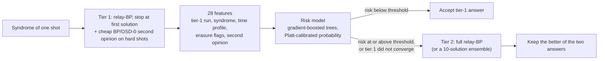
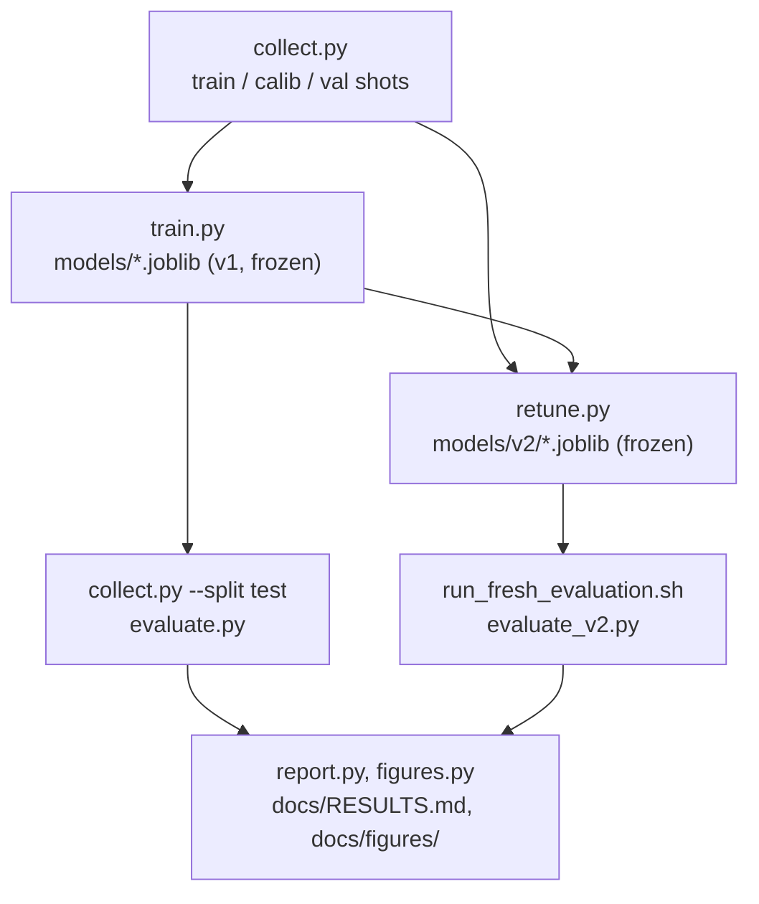

# How QEC-Aegis works, from first principles to code

This page explains the idea step by step and points to the code that implements each step. Reading the files in the order of [Code tour](#code-tour) takes about 15 minutes; the core decoder is [`aegis/decoder.py`](../aegis/decoder.py), 69 lines.

## 1. The problem
A quantum memory stores logical qubits in many physical qubits. Every syndrome cycle measures parity checks; a check that flips is an *alarm*. A **decoder** reads the alarms of a shot (12 cycles here) and guesses which errors happened, so the logical information can be corrected. It must be **accurate** (rarely guess a logically wrong correction) and **fast** (keep up with the hardware).

The challenge uses the **[[144,12,12]] Gross code**: 12 logical qubits in 144 data qubits. Its decoding problem has 936 checks and 8,784 possible error mechanisms per basis ([`challenge-1-ml-decoder-kit/circuit.py`](../challenge-1-ml-decoder-kit/circuit.py)). The kit's two baselines are:

| Decoder | Accuracy | Speed |
|---|---|---|
| BP-OSD | lower | steady: tens to a few hundred ms per pair |
| relay-BP | 3–6× fewer failures than BP-OSD | fast on easy shots, very slow on hard ones |

## 2. The observation
Most shots are easy. A short relay-BP run (stop at the first solution) usually finds an answer that explains every alarm; in QEC-Aegis that answer is final on 93–99.96% of shots, depending on p. Two things can go wrong:

1. **It does not converge.** That is visible, and the obvious fix is to escalate.
2. **It converges to a logically wrong answer.** That is invisible to convergence checks, and it is where a fast decoder loses accuracy against the full one.

QEC-Aegis targets case 2: *given that the fast decoder converged, how likely is its answer to be wrong?*

## 3. The design

- **Tier 1** (`relay1`): relay-BP with `stop_nconv=1`. On shots it found hard, a cheap BP with order-0 OSD gives a second opinion that errs differently.
- **Features** ([`aegis/features.py`](../aegis/features.py)): 28 numbers available at decode time and never from the truth. They come in five groups: the tier-1 run (iterations, solution weight, posterior margins, uncertain bits), the syndrome (weight, spread over checks), the time profile over rounds, erasure flags, and the second opinion.
- **Risk model** ([`aegis/model.py`](../aegis/model.py)): a `HistGradientBoostingClassifier`, Platt-calibrated, so the output is a probability and one threshold means the same at every noise level. At run time a compiled tree walk gives scikit-learn's exact score in ~60 µs.
- **Tier 2**: full relay-BP (`relay`) or a 10-solution ensemble (`strong10`). The final answer is the lighter of the two converged answers.
- **Threshold and tier 2** are not tuned by hand; each is chosen on validation shots by one of two rules:

  | Mode | Rule |
  |---|---|
  | speed | fastest with no more failures than relay-BP |
  | accuracy | fewest failures with no more time than relay-BP |

## 4. The scientific protocol
Every number in the results comes from shots that played no part in any choice made before them.

| Split | Seed | Used for |
|---|---|---|
| train | 1 | fit the risk models |
| calibration | 4 | Platt scaling |
| validation | 3 | choose tiers, model, threshold (v1) and per-setting operating points (v2) |
| test | 2 | v1 evaluation; models frozen first (`experiments/reports/frozen_models.json`) |
| fresh test / fresh timing | 7 / 8 | v2 evaluation; v2 frozen first (`experiments/reports/v2_frozen.json`) |
| demo | 99 | `python -m aegis.demo` |

- **Same shots everywhere:** every decoder decodes the same shots and is scored on the same independent X/Z pairs (`analyze.z_partner`). Statistics are exact: Clopper–Pearson intervals, McNemar tests on paired failures, and bootstrap intervals on speedups.
- **Timing conditions:** latency is measured on one worker with nothing else running.
- **Reproducible records:** a record is a function of (basis, p, f, seed, shots, chunk size). [`aegis/reproduce.py`](../aegis/reproduce.py) re-samples every committed record and can re-decode chunks bit for bit.

## Code tour
Read in this order. Each file starts with a docstring that says what it does and how to run it.

| # | File | Role |
|---|---|---|
| 1 | [`aegis/problem.py`](../aegis/problem.py) | One decoding problem: the kit's circuit at noise p (optionally with heralded erasure), its check matrix and priors, and shot sampling |
| 2 | [`aegis/tiers.py`](../aegis/tiers.py) | Every decoder as a *tier* with one interface: the baselines `bposd` and `relay`, tier 1 `relay1`, tier 2 `strong10` |
| 3 | [`aegis/features.py`](../aegis/features.py) | The 28 features computed from a tier-1 run |
| 4 | [`aegis/model.py`](../aegis/model.py) | Risk model: training, Platt calibration, and the compiled tree walk |
| 5 | [`aegis/decoder.py`](../aegis/decoder.py) | **The decoder**: tier 1 → risk → maybe tier 2 → better answer |
| 6 | [`aegis/collect.py`](../aegis/collect.py) | Data generation: decode fixed shots with chosen tiers and store per-shot records; checkpointed and resumable |
| 7 | [`aegis/policy.py`](../aegis/policy.py) | Scoring routing policies on stored records; pairing and statistics |
| 8 | [`aegis/train.py`](../aegis/train.py) | Fit, calibrate and select v1 on train/calibration/validation shots |
| 9 | [`aegis/retune.py`](../aegis/retune.py) | v2: per-setting operating points on validation shots, then freeze hashes |
| 10 | [`aegis/evaluate.py`](../aegis/evaluate.py), [`aegis/evaluate_v2.py`](../aegis/evaluate_v2.py) | Evaluation of v1 (seed 2) and v2 (seeds 7, 8) against the baselines |
| 11 | [`aegis/report.py`](../aegis/report.py), [`aegis/figures.py`](../aegis/figures.py) | Generate [`RESULTS.md`](RESULTS.md) and every plot from the stored evaluation; no number is typed by hand |
| 12 | [`aegis/demo.py`](../aegis/demo.py) | Live demo on fresh shots |

Supporting modules:

| File | Role |
|---|---|
| [`aegis/paths.py`](../aegis/paths.py) | Repository paths |
| [`aegis/reproduce.py`](../aegis/reproduce.py) | Record reproduction |
| [`aegis/recheck.py`](../aegis/recheck.py) | Re-scores v1's selection with corrected pairing |
| [`aegis/resources.py`](../aegis/resources.py) | Per-decoder memory and setup cost |

The kit in `challenge-1-ml-decoder-kit/` provides `circuit`, `decoders`, `lossy` and `analyze`; QEC-Aegis imports them unchanged.

## Data flow

| Location | Contents |
|---|---|
| `experiments/records/` | Per-shot records (committed) |
| `experiments/reports/` | Evaluations, selections and frozen hashes |
| `experiments/manifest.json` | The provenance of every decoding run: command, machine, package versions, wall and CPU time |
