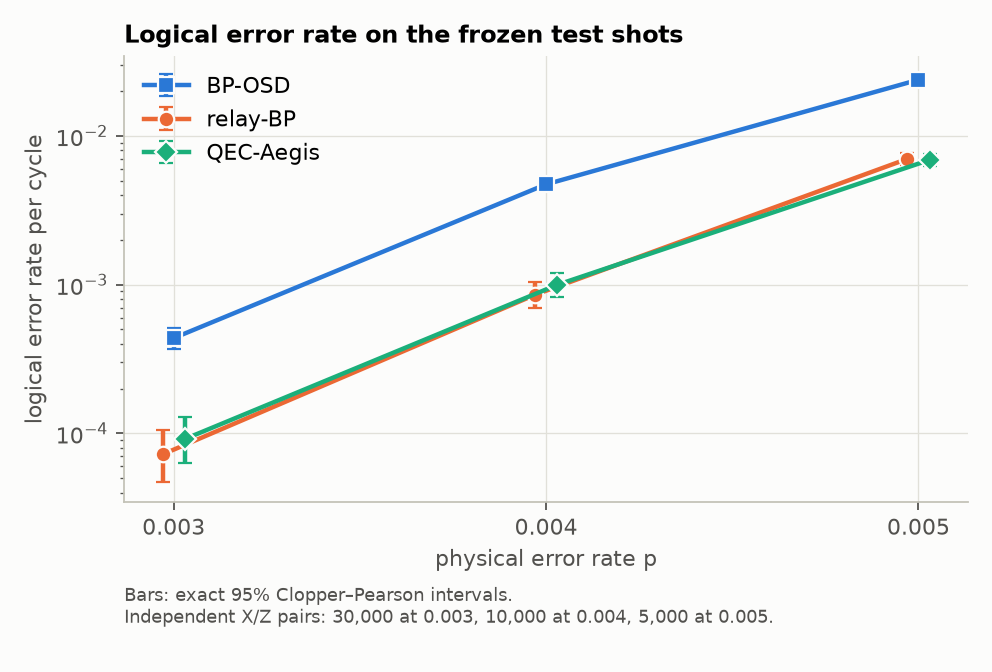
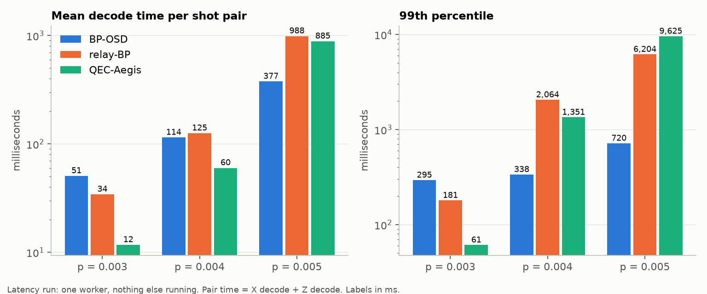
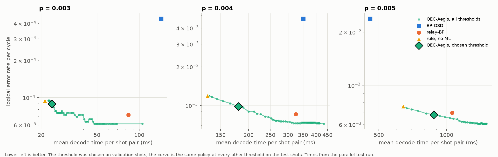
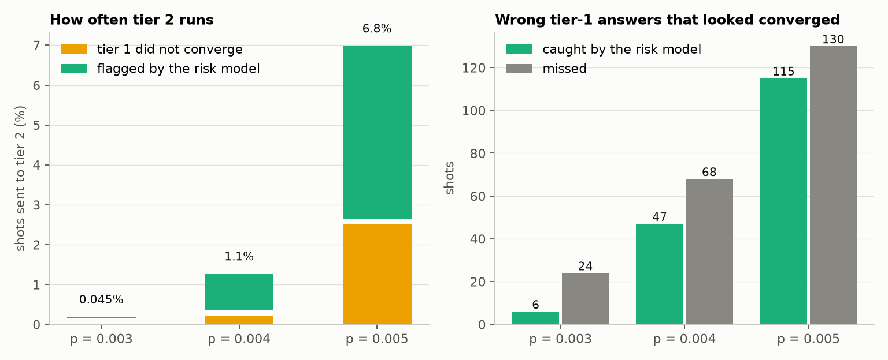
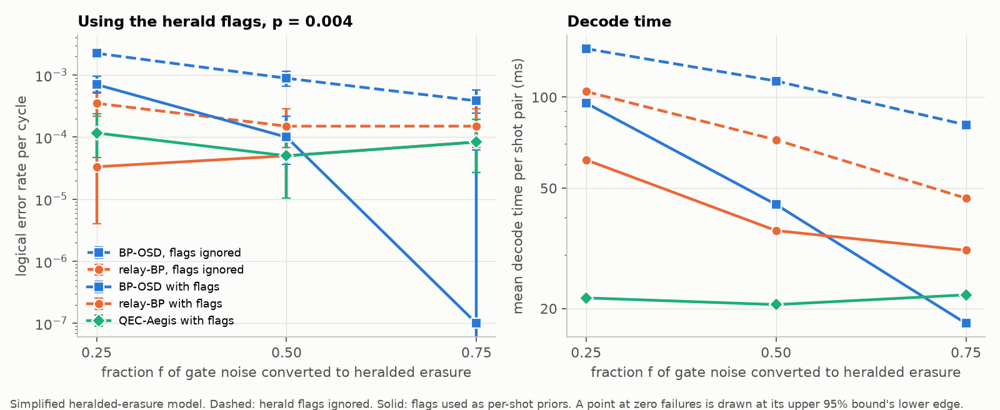
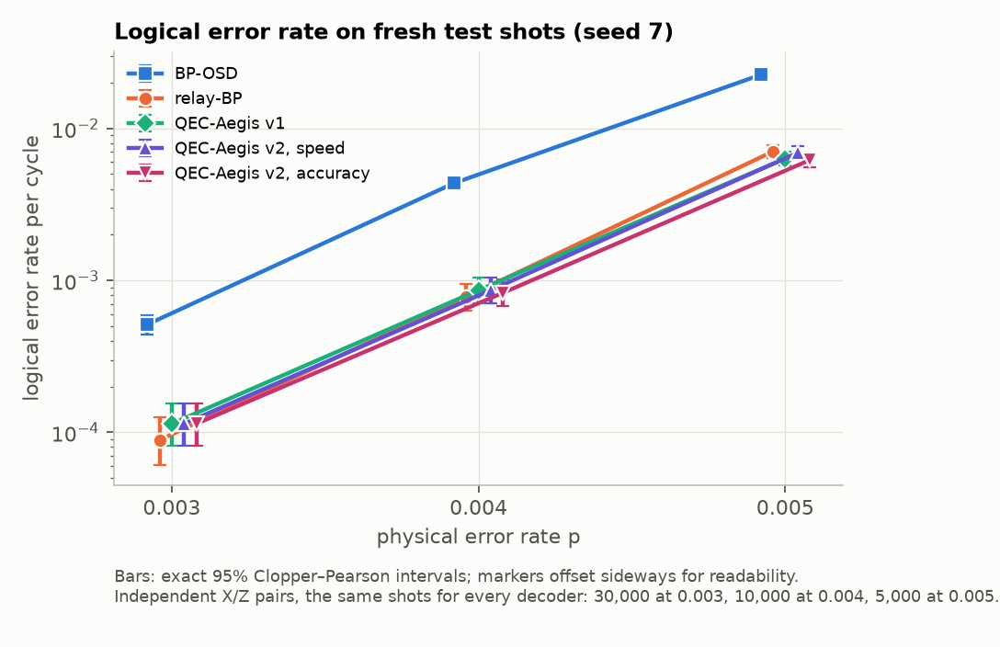
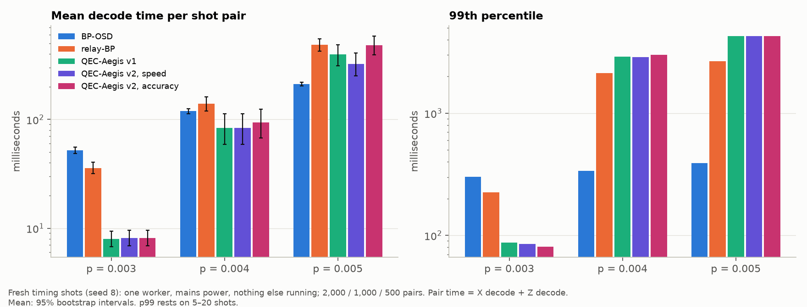

# QEC-Aegis: full evaluation and discussion

The headline numbers are in the [README](../README.md); every generated table is in [RESULTS.md](RESULTS.md). This page keeps the complete discussion: the first frozen version (v1) on the seed-2 test shots, v2 on fresh shots, and every place the decoder works or falls short.

## v1 on the frozen test shots (seed 2)
`aegis/` (repository root) routes on a different question: *given that a fast, early-stopping relay-BP (tier 1) converged, is its answer wrong?* A calibrated gradient-boosted model reads tier-1, syndrome, temporal, loss and second-opinion features and sends risky shots to full relay-BP (tier 2). Models, tiers and threshold were chosen on validation shots and frozen (hashes in `experiments/reports/frozen_models.json`) before any test shot was decoded. Test shots are the frozen seed-2 records in `experiments/records/`, with X/Z pairs formed exactly as `analyze.py` does (`z_partner`). The online row is the routed decoder run as one program:

| p | Test pairs | relay-BP failed pairs | QEC-Aegis failed pairs | McNemar p | Mean ms, one worker: relay-BP → QEC-Aegis | Speedup [95%] |
|---|---|---|---|---|---|---|
| 0.003 | 30,000 | 26 | 33 | 0.25 | 34 → 12 | 2.9× [2.1–4.2] |
| 0.004 | 10,000 | 102 | 119 | 0.10 | 125 → 60 | 2.1× [1.7–2.8] |
| 0.005 | 5,000 | 404 | 398 | 0.75 | 988 → 885 | 1.1× [1.0–1.3] |

Error rates are statistically indistinguishable from relay-BP at every p; the point estimate is worse at p = 0.003 and 0.004 (LER ratio 1.27 and 1.17, both intervals include 1). Times are from separate single-worker timing shots (seed 5). The gain shrinks with noise as more shots need tier 2 (0.04%, 1.1% and 6.8% escalated), and at p = 0.005 the slowest 1% are slower than relay-BP. The required sweep (LER, latency percentiles and per-decoder resources for BP-OSD, relay-BP and QEC-Aegis side by side) is the first section of [docs/RESULTS.md](RESULTS.md), followed by the oracle-router bound, erasure settings and calibration; verify with `scripts/reproduce.sh`.







What each plot shows: [FIGURES.md](FIGURES.md).

## v2 on fresh shots (seeds 7 and 8)
**QEC-Aegis v2 (fresh shots).** v2 keeps v1's risk models but picks the second tier and threshold separately for each setting, on validation shots only, in two modes: *speed* (fastest with no more failed pairs than relay-BP) and *accuracy* (fewest failed pairs, no slower than relay-BP). Its files were hashed in `experiments/reports/v2_frozen.json` before decoding. Because the v1 test results shaped v2, v2 is scored only on fresh shots: seed 7 for error rates, and seed 8 for single-worker timing on mains power with nothing else running. Baselines and v1 were decoded again on the same shots. The risk model now runs as a compiled tree walk (same value as scikit-learn, ~60 µs instead of ~600 µs per call), and v1 uses it too here.

| p | relay-BP failed pairs | v1 | v2 speed | v2 accuracy | Mean ms, one worker: relay-BP / v1 / v2 speed / v2 accuracy |
|---|---|---|---|---|---|
| 0.003 | 32 | 41 | 41 | 41 | 35.8 / 8.0 / 8.1 / 8.1 |
| 0.004 | 93 | 103 | 103 | 99 | 139 / 84 / 84 / 94 |
| 0.005 | 407 | 367 | 399 | 359 | 484 / 397 / 325 / 482 |

Test pairs: 30,000, 10,000 and 5,000. Full tables, paired comparisons and erasure settings are in [docs/RESULTS.md](RESULTS.md) under "QEC-Aegis v2 on fresh shots".




## Where it works and where it falls short

### v1 (seed-2 test shots)
- *Works:* the hierarchy pays off where most shots are easy. Tier 1 settles 99.96%, 98.9% and 93.2% of shots at p = 0.003, 0.004, 0.005, so on one worker the median pair takes 4.4 vs 21.0 ms (relay-BP) at p = 0.003 and 6.2 vs 39.6 ms at p = 0.004; the mean is 2.9× and 2.1× faster and the slowest 1% 3.0× and 1.5× faster, at relay-BP accuracy (McNemar p = 0.25, 0.10).
- *Works:* against BP-OSD it fails on 3–5× fewer pairs at every p (33 vs 157, 119 vs 552, 398 vs 1,256; LER ratio 0.21, 0.21, 0.29; McNemar p < 1e-24) and is 4.3× and 1.9× faster on average at p = 0.003 and 0.004.
- *Works:* the learned risk model finds wrong answers that convergence alone cannot see. Escalating only non-converged shots (no ML) fails on more pairs at p = 0.004 and 0.005 (QEC-Aegis / rule LER ratio 0.84 and 0.91, McNemar p = 0.001 and 2e-4). On test shots the model ranks converged-but-wrong tier-1 answers with AUC 0.98, 0.96, 0.92.
- *Works:* small footprint. Same 936 × 8,784 check matrix as the baselines, a 274 kB model, 70–74 MB on top of the problem (174–179 MB peak per process, vs 167–169 MB for BP-OSD), 0.05 s setup plus a one-time ~0.9 s scikit-learn import, CPU only (measured on an Apple M5 laptop; other machines differ).
- *Falls short:* it is not more accurate than relay-BP; the point estimate is worse at p = 0.003 and 0.004 (LER ratio 1.27 and 1.17, intervals include 1). Speed mode was chosen to *match* relay-BP on validation shots, not beat it.
- *Falls short:* the speedup collapses at p = 0.005 (1.12× mean, interval 0.99–1.30). Escalated shots pay for tier 1 and tier 2, so p95/p99 are worse than relay-BP (6.2 vs 4.2 s and 9.6 vs 6.2 s), and BP-OSD is 2.3× faster on average there (at 3.2× more failed pairs).
- *Falls short:* far from a perfect router. Of the converged-but-wrong tier-1 answers the model sends 6 of 30, 47 of 115 and 115 of 245 to tier 2; the oracle router (knows the truth) has 1.9×, 1.7× and 1.3× fewer failed pairs.
- *Falls short:* latencies are Python on a laptop CPU, milliseconds to seconds per pair, orders of magnitude above real-time budgets; the 626 µs per-shot model call (scikit-learn overhead) is a visible share of tier 1 at p = 0.003. Under erasure (f = 0.25) it fails on 7 pairs vs 2 for flag-aware relay-BP (p = 0.06), with a threshold borrowed from the sweep rather than validated. At p = 0.003 only 26–33 pairs fail, too few to resolve differences of about 25%.

### v2 (fresh shots)
- *Works:* at p = 0.005, speed mode is 1.49× faster than relay-BP on one worker (v1: 1.22×) at relay-BP accuracy (LER ratio 0.98, McNemar p = 0.67). Accuracy mode has the lowest error rate of any decoder there (LER ratio 0.88 vs relay-BP, McNemar p = 0.002) at the same mean time (1.00×).
- *Works:* at 25% erasure, v2 closes v1's gap to flag-aware relay-BP (9 and 8 failed pairs vs 9; v1 12).
- *Works:* v1 replicates on fresh shots: 4.5×, 1.7× and 1.2× faster than relay-BP on one worker, and at p = 0.005 it is more accurate than relay-BP (LER ratio 0.90, McNemar p = 0.01).
- *Falls short:* at p = 0.003 and 0.004, v2 brings nothing over v1 (same or near-same failed pairs and times). Neither mode beats relay-BP's error rate there (LER ratio 1.06–1.28, intervals include 1).
- *Falls short:* speed at p = 0.005 costs accuracy against v1: 399 vs 367 failed pairs, a significant difference (McNemar p = 0.001). That is within the rule it was chosen by, which only asks to match relay-BP.
- *Falls short:* the slowest shots are still slower than relay-BP (p99 4.3 vs 2.7 s at p = 0.005, 2.9 vs 2.1 s at p = 0.004). BP-OSD remains faster on average at p = 0.005 (212 ms), at 3× more failed pairs. At 25% erasure, v2 sends 4.5% of shots to tier 2, so it is about half as fast as v1.
- *Falls short:* single-worker timing used 2,000, 1,000 and 500 pairs per p, so p99 rests on 5–20 shots.

### Model limits
- Erasures are *idealized*. Flags fire instantly at the gate with the exact location, and the qubit returns to the code space. Real atom loss is detected later and a lost atom keeps causing errors. Preparation and measurement errors are not converted. The DEM/decoder also approximates correlations between disjoint Pauli outcomes; corrected conditional marginals do not make it an exact joint decoder.

## Data and provenance
- **Per-shot records** (committed, 100 MB): [`experiments/records/`](../experiments/records/). One `.npz` per split, basis, p and erasure fraction, with every decoder's outcome, time, iterations, tier-2 decision and tier-1 features. `python -c "from aegis.collect import load; r = load('experiments/records/test2_X_p0.004.npz'); print(r['relay']['failed'].sum())"`.
- **Evaluation outputs:** [`experiments/reports/v2_evaluation.json`](../experiments/reports/v2_evaluation.json) (all rows and paired comparisons) and [`v2_summary.csv`](../experiments/reports/v2_summary.csv) (one row per p and decoder). Provenance of every run (command, machine, package versions, wall and CPU time) is in [`experiments/manifest.json`](../experiments/manifest.json).
- **Seeds:** train 1, test 2, validation 3, calibration 4, timing 5, resources 6, fresh test 7, fresh timing 8, demo 99. Training shots (60,000 / 40,000 / 30,000 at p = 0.003 / 0.004 / 0.005) are regenerated, not committed:
  ```bash
  python -m aegis.collect --split train --p 0.003 --shots 60000 --tiers fast relay1      # also 0.004: 40000, 0.005: 30000
  python -m aegis.collect --split calib --p 0.003 --shots 10000 --tiers fast relay1      # each p
  python -m aegis.train                                                                  # fit, calibrate, choose v1
  python -m aegis.retune                                                                 # v2 operating points (validation only)
  scripts/run_fresh_evaluation.sh all                                                    # fresh test and timing shots, evaluation
  python -m aegis.report && python -m aegis.figures                                      # docs/RESULTS.md and docs/figures/
  ```
  Refitting replaces the frozen models, whose hashes are checked against [`frozen_models.json`](../experiments/reports/frozen_models.json) and [`v2_frozen.json`](../experiments/reports/v2_frozen.json).
- QEC-Aegis records are functions of (basis, p, f, seed, shots, chunk size) and the package versions in `requirements-local-lock.txt`; `python -m aegis.reproduce` checks them. Training records (`data/`) are not committed and are only needed to refit models with `python -m aegis.train`, which would replace the frozen models.
