# Figures

Every plot in this repository, with what it shows and how to read it.
- **Generated, not drawn by hand:** QEC-Aegis figures come from the stored evaluations (`python -m aegis.figures`); the erasure-study figures come from the kit (`challenge-1-ml-decoder-kit/make_figures.py`).
- **Consistent colours:** each decoder keeps its colour in every plot: BP-OSD blue, relay-BP orange, QEC-Aegis green.
- **Lower is better** on every axis.

## Contents
- [Headline comparison: QEC-Aegis v2 on fresh shots](#headline-comparison-qec-aegis-v2-on-fresh-shots)
  - [1. Logical error rate against noise](#1-logical-error-rate-against-noise)
  - [2. Decoding latency](#2-decoding-latency)
  - [3. Accuracy against speed](#3-accuracy-against-speed)
- [Why the machine learning works](#why-the-machine-learning-works)
  - [4. The risk model is calibrated](#4-the-risk-model-is-calibrated)
  - [5. What the router does](#5-what-the-router-does)
  - [6. The threshold trade-off](#6-the-threshold-trade-off)
- [QEC-Aegis v1 on the frozen test shots (seed 2)](#qec-aegis-v1-on-the-frozen-test-shots-seed-2)
  - [7. Logical error rate](#7-logical-error-rate)
  - [8. Latency](#8-latency)
  - [9. Under heralded erasure](#9-under-heralded-erasure)
- [Companion study: erasure flags](#companion-study-erasure-flags)
  - [10. relay-BP with and without flags](#10-relay-bp-with-and-without-flags)
  - [11. BP-OSD with and without flags](#11-bp-osd-with-and-without-flags)
  - [12. Hybrid decoder latency](#12-hybrid-decoder-latency)
  - [13. Latency with both baselines](#13-latency-with-both-baselines)

---

## Headline comparison: QEC-Aegis v2 on fresh shots

### 1. Logical error rate against noise
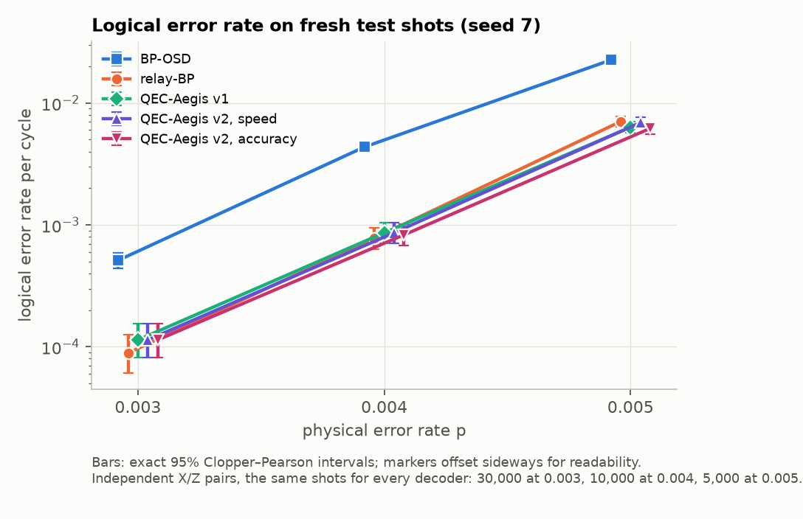

The challenge's required sweep, p = 0.003, 0.004, 0.005. All three QEC-Aegis variants lie on relay-BP's line and far below BP-OSD. At p = 0.005, accuracy mode is the lowest point, significantly below relay-BP (McNemar p = 0.002). Seed 7: 30,000, 10,000 and 5,000 X/Z pairs. Bars are exact 95% intervals.

### 2. Decoding latency
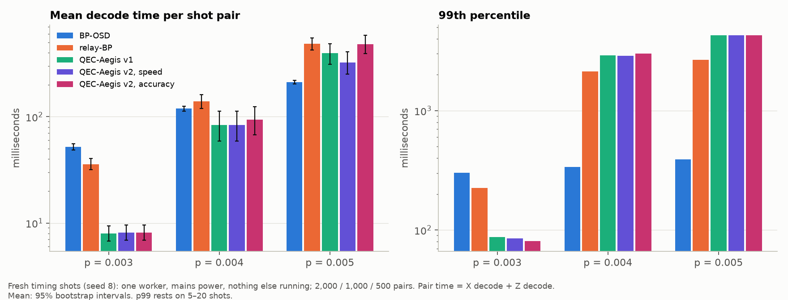

- **Left, mean time:** QEC-Aegis beats relay-BP at every p: 4.5× faster at p = 0.003 and 1.7× at p = 0.004 (v1), and 1.5× at p = 0.005 (v2 speed).
- **Right, slowest 1% of shots:** here QEC-Aegis is slower than relay-BP at p ≥ 0.004, because a shot that escalates pays for both tiers. This is its main weakness.

Measured on separate timing shots (seed 8), one worker, nothing else running.

### 3. Accuracy against speed
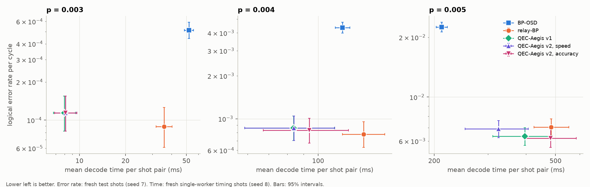

Each decoder is one point; lower left is better.
- At p = 0.003 and 0.004, QEC-Aegis sits to the left of relay-BP: much faster, with overlapping error bars.
- At p = 0.005, v2 speed mode is the fastest of the accurate decoders, and accuracy mode is the most accurate.
- BP-OSD is fast at p = 0.005 but 3× less accurate.

---

## Why the machine learning works

### 4. The risk model is calibrated
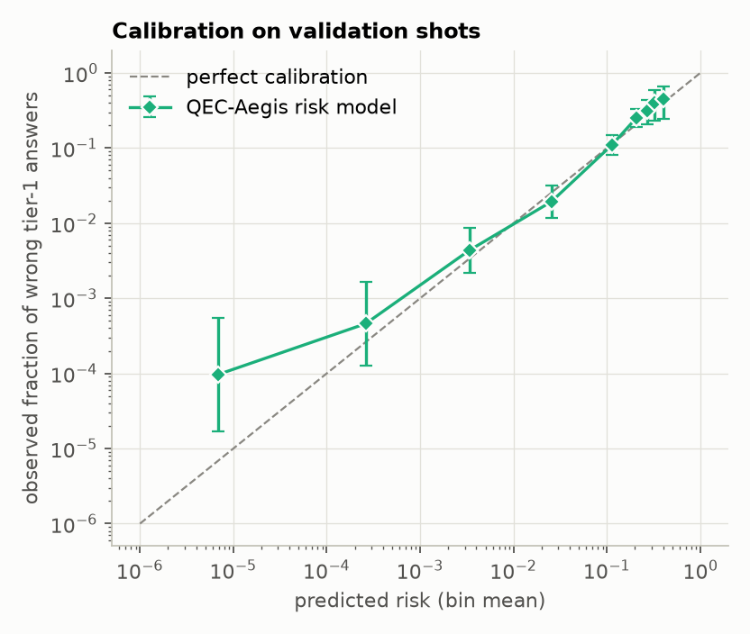

The model's predicted probability that a converged tier-1 answer is wrong, against how often it really was wrong, on validation shots. Points follow the diagonal from about 1e-3 to 0.5, so a threshold means the same thing at every noise level. The lowest bin is the exception: predicted about 7e-6, observed about 1e-4. Very low risks are underestimated, though that bin holds only a handful of wrong answers.

### 5. What the router does
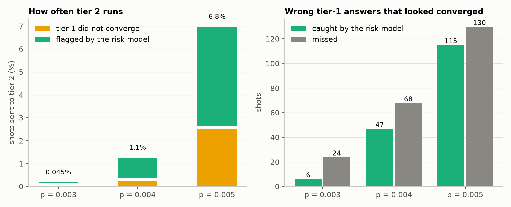

- **Left:** only 0.045%, 1.1% and 6.8% of shots go to tier 2. Orange shots had a tier 1 that did not converge; green shots were flagged by the model.
- **Right:** converged-but-wrong answers, the failures a convergence check cannot see. The model catches 6 of 30, 47 of 115 and 115 of 245. The misses are why an oracle router would still fail 1.3–1.9× less often.

Shown for v1 on the seed-2 test shots.

### 6. The threshold trade-off
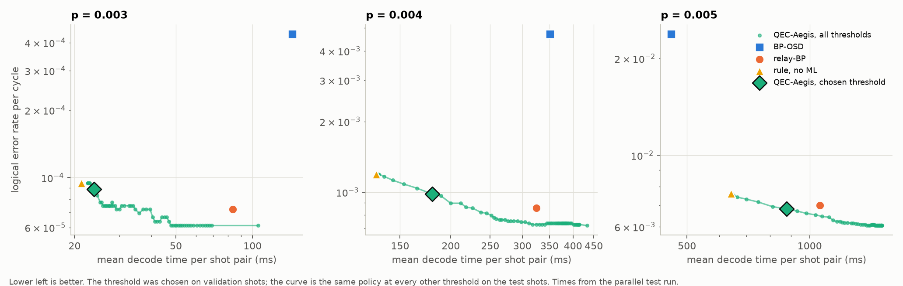

- **Green curve:** the same routed decoder at every threshold, from "never escalate" on the left to "escalate often" on the right.
- **Large diamond:** the threshold chosen on validation shots before testing; the test curve confirms it was a sensible choice.
- **Orange triangle ("rule, no ML"):** escalates only non-converged shots. It is faster but less accurate, which shows the learned model buys accuracy.

Times are from the parallel test run.

---

## QEC-Aegis v1 on the frozen test shots (seed 2)

### 7. Logical error rate
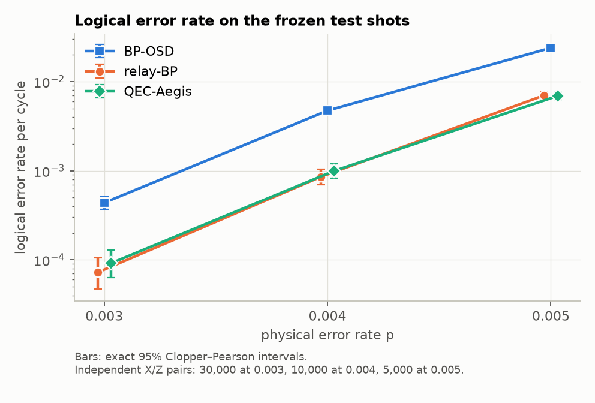

v1 against the baselines on the first frozen test set. Its error rate is statistically indistinguishable from relay-BP's at every p.

### 8. Latency
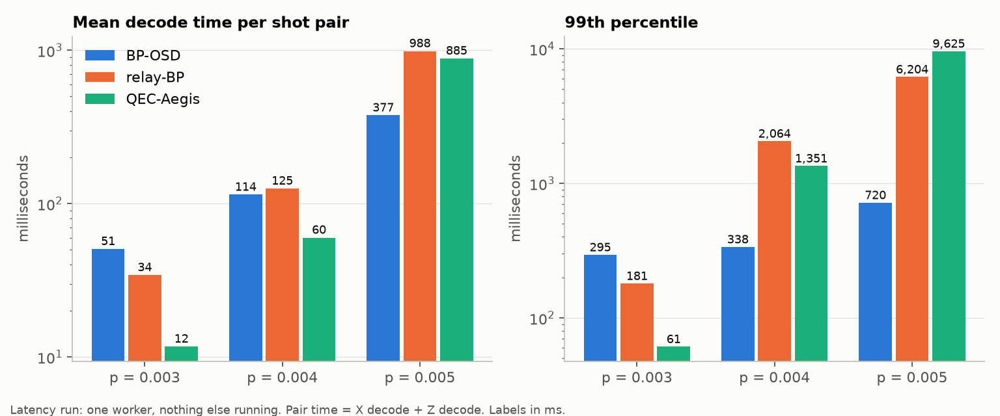

Single-worker timing shots (seed 5).
- **Mean time:** 12 vs 34 ms and 60 vs 125 ms against relay-BP at p = 0.003 and 0.004; only 885 vs 988 ms at p = 0.005.
- **Slowest 1%:** worse than relay-BP at p = 0.005. This result motivated v2.

### 9. Under heralded erasure
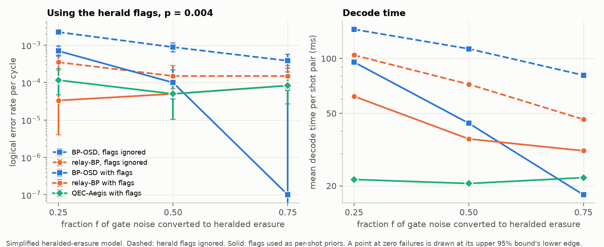

Part of the noise (fraction f) is converted into flagged erasures at p = 0.004. Dashed lines ignore the flags; solid lines use them as per-shot priors.
- **Accuracy:** QEC-Aegis with flags is within the error bars of flag-aware relay-BP at f = 0.5 and 0.75, but worse at f = 0.25 (7 vs 2 failed pairs, McNemar p = 0.06). v2 closes that gap on fresh shots.
- **Time:** it is the fastest decoder at f = 0.25 and 0.5.
- **Zero failures:** a decoder with zero failures (BP-OSD at f = 0.75) is drawn at the bottom of the axis.

---

## Companion study: erasure flags
From [ERASURE.md](ERASURE.md), produced by the challenge kit.

### 10. relay-BP with and without flags
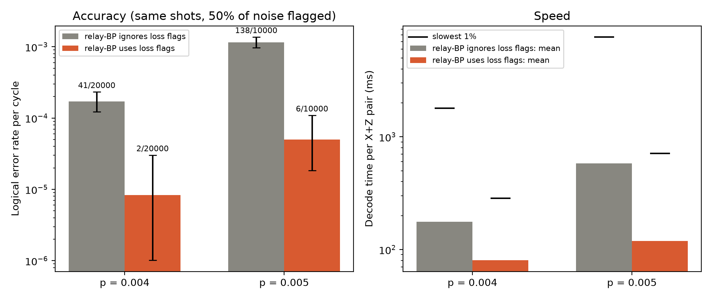

### 11. BP-OSD with and without flags
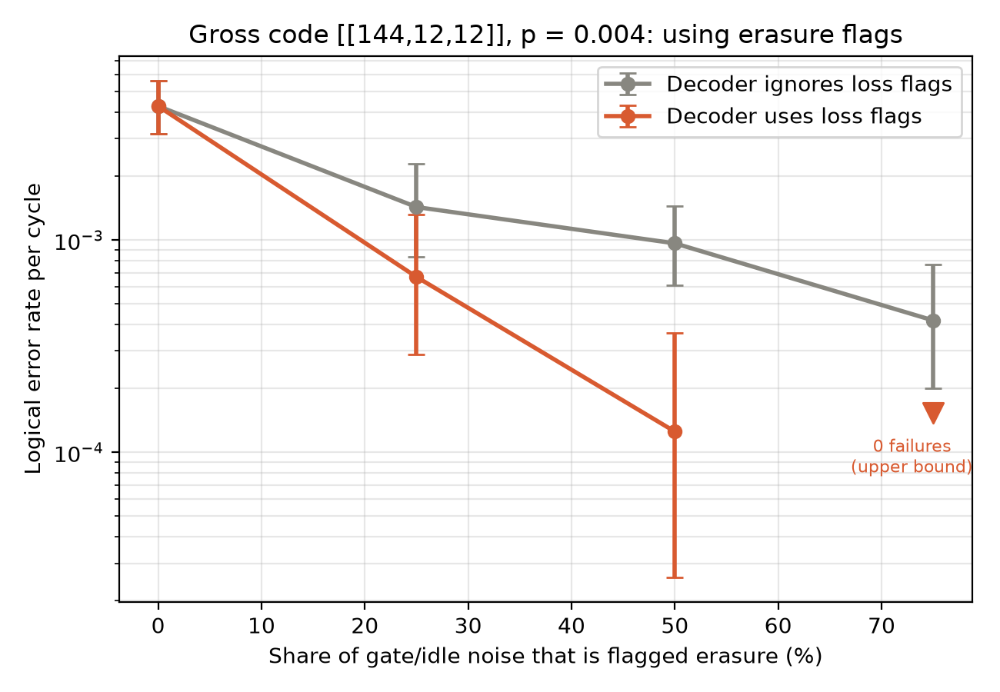

### 12. Hybrid decoder latency
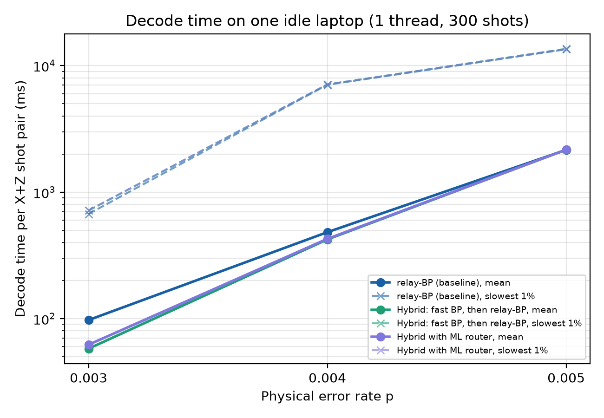

### 13. Latency with both baselines
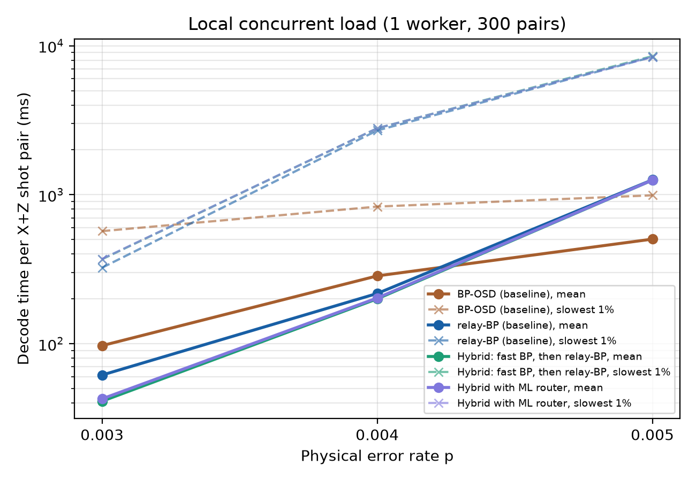
