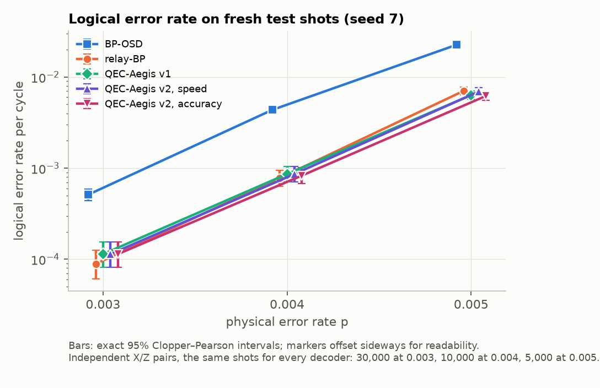

# QEC-Aegis: a five-minute presentation

One heading per slide. Numbers come from fresh shots that no design or tuning step saw ([RESULTS.md](RESULTS.md)).

---

## 1. The problem
- A decoder reads the alarms of a quantum memory and must correct errors **accurately** and **fast**.
- On the [[144,12,12]] Gross code, relay-BP is accurate but very slow on hard shots; BP-OSD is steadier but fails 3–6× more often.
- **Question:** can machine learning decide *per shot* when the fast answer can be trusted?

## 2. The idea
- Most shots are easy: a short relay-BP run (tier 1) converges to the right answer.
- The danger is a tier-1 answer that **converges and is still wrong**. No convergence check can see it.
- QEC-Aegis reads 28 features of the tier-1 run and predicts a **calibrated probability that the answer is wrong**. Only risky shots go to full relay-BP (tier 2).

```
syndrome → tier 1 (fast relay-BP) → 28 features → risk model → accept   (most shots)
                                                              → tier 2  (risky shots)
```

## 3. Done honestly
- The model is fit on seed-1 shots, calibrated on seed-4 shots, and its threshold is chosen on seed-3 validation shots.
- The model files are **hashed before any test shot is decoded**.
- v2 was designed after v1's results, so it is scored only on **fresh** shots: seed 7 for accuracy, seed 8 for single-worker timing.
- Every decoder decodes the same shots. Paired exact tests (McNemar), exact intervals (Clopper–Pearson).

## 4. Results
Failed X/Z pairs · mean time per pair (one worker):

| p | BP-OSD | relay-BP | QEC-Aegis v1 | v2 speed | v2 accuracy |
|---|---|---|---|---|---|
| 0.003 | 184 · 52 ms | 32 · 36 ms | 41 · **8 ms** | 41 · 8 ms | 41 · 8 ms |
| 0.004 | 511 · 119 ms | 93 · 139 ms | 103 · **84 ms** | 103 · 84 ms | 99 · 94 ms |
| 0.005 | 1,196 · 212 ms | 407 · 484 ms | 367 · 397 ms | 399 · **325 ms** | **359** · 482 ms |

- **Faster than relay-BP on average, with no significant loss of accuracy:** 4.5× and 1.7× at p = 0.003 and 0.004 (v1), and 1.5× at p = 0.005 (v2 speed).
- At p = 0.005, accuracy mode is **significantly more accurate than relay-BP** (LER ratio 0.88, McNemar p = 0.002) at the same mean time.
- **3–5× fewer failures than BP-OSD** at every p.



## 5. Limits and next steps
- **Tail latency:** the slowest 1% are slower than relay-BP, because escalated shots pay for both tiers. The next step is to start tier 2 early, or run it in parallel.
- **Missed wrong answers:** the risk model misses some (the live demo shows one). On v1's test shots, an oracle router would fail 1.3–1.9× less often, so there is headroom.
- **Implementation:** Python on a laptop CPU, milliseconds per shot. A real-time decoder needs compiled code on dedicated hardware.
- **Erasures:** the erasure model is idealized. Our companion study ([ERASURE.md](../challenge-1-ml-decoder-kit/ERASURE.md)) shows that loss flags alone cut relay-BP failures over 10×.

**Live demo:** `python -m aegis.demo --p 0.005 --shots 15`
