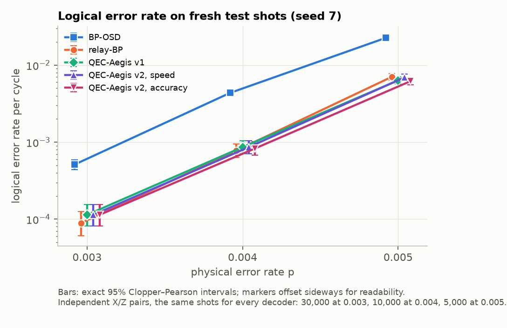
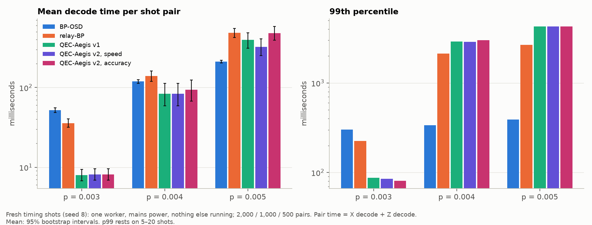
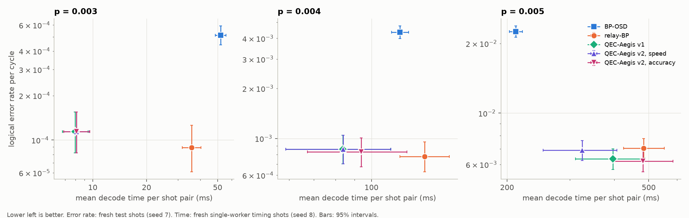
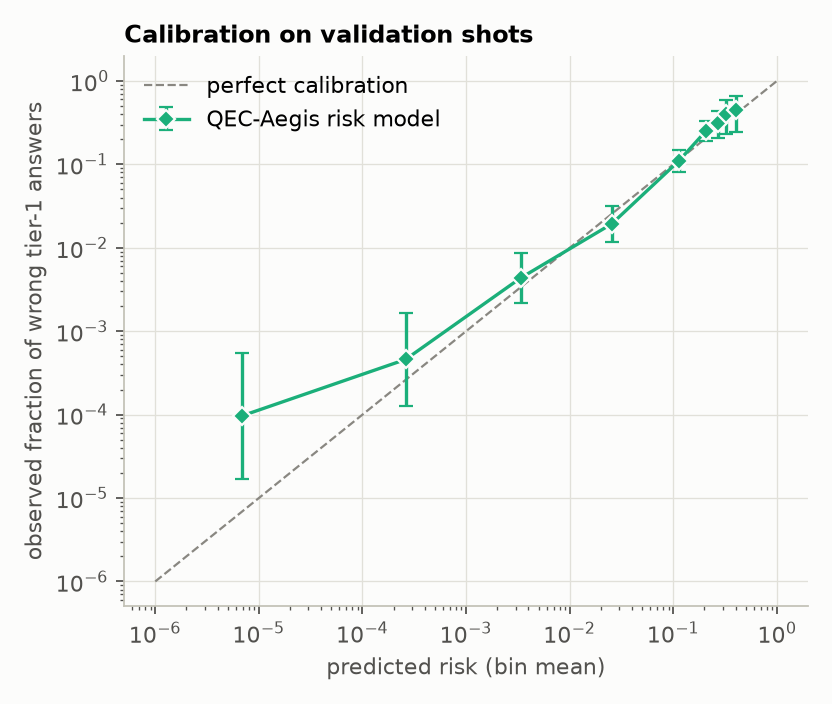
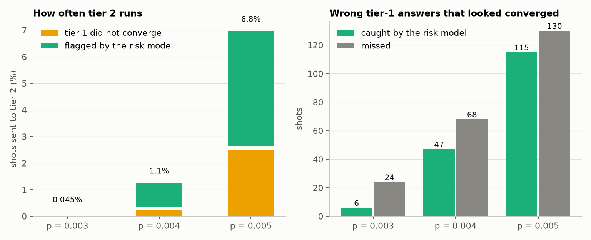
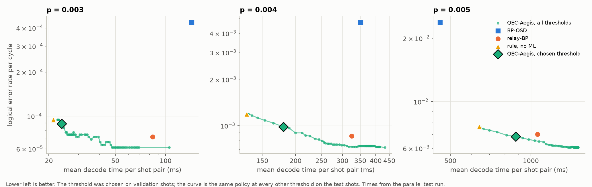
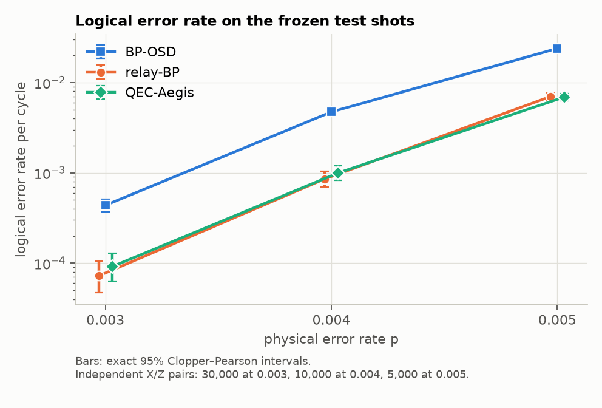
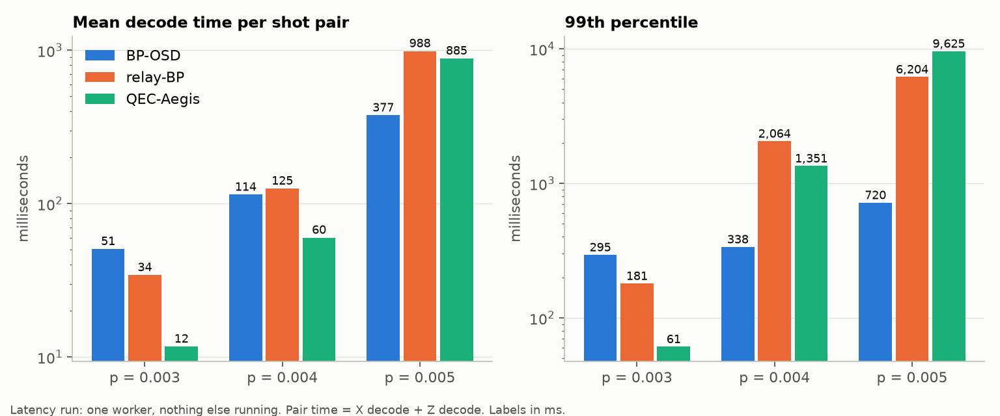
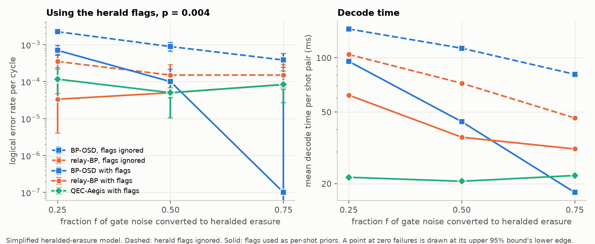

# Results

Everything measured for QEC-Aegis, in reading order:
1. the headline comparison on fresh shots;
2. why the machine learning works;
3. where it works and where it falls short;
4. the earlier v1 test;
5. the data behind it all.

Every number here also appears in the generated tables, [`results/tables.md`](../results/tables.md), which are written by `python -m aegis.report` and never edited by hand.

Each decoder keeps its colour in every plot: BP-OSD blue, relay-BP orange, QEC-Aegis green, v2 speed purple, v2 accuracy pink. Lower is better on every axis.

## Contents
1. [Headline: QEC-Aegis v2 against the baselines on fresh shots](#1-headline-qec-aegis-v2-against-the-baselines-on-fresh-shots)
2. [Why the machine learning works](#2-why-the-machine-learning-works)
3. [Where it works and where it falls short](#3-where-it-works-and-where-it-falls-short)
4. [Earlier test: QEC-Aegis v1 on the frozen seed-2 shots](#4-earlier-test-qec-aegis-v1-on-the-frozen-seed-2-shots)
5. [Data and how to regenerate it](#5-data-and-how-to-regenerate-it)

---

## 1. Headline: QEC-Aegis v2 against the baselines on fresh shots
v2 keeps v1's risk models and chooses, for each noise level and on validation shots only, the second tier and threshold in two modes:

| Mode | Rule |
|---|---|
| speed | fastest with no more failures than relay-BP |
| accuracy | fewest failures with no more time than relay-BP |

- **Frozen before testing:** its model files were hashed in [`results/v2_frozen.json`](../results/v2_frozen.json) before any fresh shot was decoded.
- **Fresh shots only:** v1's test results shaped v2, so v2 is scored only on fresh shots. Seed 7 measures error rates; seed 8 measures single-worker timing on mains power with nothing else running.
- **Same shots for every decoder:** the baselines and v1 decoded the same fresh shots.

Failed X/Z pairs · mean time per pair:

| p | Test pairs | BP-OSD | relay-BP | QEC-Aegis v1 | v2 speed | v2 accuracy |
|---|---|---|---|---|---|---|
| 0.003 | 30,000 | 184 · 52 ms | 32 · 36 ms | 41 · **8.0 ms** | 41 · 8.1 ms | 41 · 8.1 ms |
| 0.004 | 10,000 | 511 · 119 ms | 93 · 139 ms | 103 · **84 ms** | 103 · 84 ms | 99 · 94 ms |
| 0.005 | 5,000 | 1,196 · 212 ms | 407 · 484 ms | 367 · 397 ms | 399 · **325 ms** | **359** · 482 ms |

### Logical error rate against noise


The challenge's required sweep. All QEC-Aegis variants lie on relay-BP's line and far below BP-OSD. At p = 0.005, accuracy mode is significantly below relay-BP (LER ratio 0.88, McNemar p = 0.002). Bars are exact 95% intervals.

### Decoding latency


- **Left, mean time:** QEC-Aegis beats relay-BP at every p: 4.5× (p = 0.003) and 1.7× (p = 0.004) with v1, and 1.5× at p = 0.005 with v2 speed mode.
- **Right, slowest 1% of shots:** QEC-Aegis is slower than relay-BP at p ≥ 0.004, because a shot that escalates pays for both tiers.

### Accuracy against speed


One point per decoder; lower left is better.
- At p = 0.003 and 0.004, QEC-Aegis is far left of relay-BP: much faster, with overlapping error bars.
- At p = 0.005, speed mode is the fastest accurate decoder, and accuracy mode is the most accurate.
- BP-OSD is fast at p = 0.005 but fails 3× as often.

---

## 2. Why the machine learning works

### The risk model is calibrated


Predicted probability that a converged tier-1 answer is wrong, against how often it really was, on validation shots. The points follow the diagonal from about 1e-3 to 0.5, so one threshold means the same at every noise level. The lowest bin is the exception: predicted about 7e-6, observed about 1e-4. That bin holds only a handful of wrong answers.

### It sends few shots to tier 2, and catches errors convergence cannot see


- **Left:** only 0.045%, 1.1% and 6.8% of shots go to tier 2. Orange shots had a tier 1 that did not converge; green shots were flagged by the model.
- **Right:** converged-but-wrong answers, which a convergence check cannot detect. The model catches 6 of 30, 47 of 115 and 115 of 245. The misses are the headroom: an oracle router would fail 1.3–1.9× less often.

Shown for v1 on the seed-2 test shots.

### The chosen threshold sits on the best trade-off


- **Green curve:** the same decoder at every threshold.
- **Large diamond:** the threshold chosen on validation shots before testing.
- **Orange triangle ("rule, no ML"):** escalates only non-converged shots. It is faster but less accurate, which shows the learned model buys accuracy.

Times are from the parallel test run.

---

## 3. Where it works and where it falls short

### v2 (fresh shots)
- *Works:* at p = 0.005, speed mode is 1.49× faster than relay-BP on one worker (v1: 1.22×) at relay-BP accuracy (LER ratio 0.98, McNemar p = 0.67). Accuracy mode has the lowest error rate of any decoder there (LER ratio 0.88, McNemar p = 0.002) at the same mean time (1.00×).
- *Works:* at 25% erasure, v2 closes v1's gap to flag-aware relay-BP (9 and 8 failed pairs vs 9; v1 12).
- *Works:* v1 replicates on fresh shots: 4.5×, 1.7× and 1.2× faster than relay-BP on one worker, and at p = 0.005 it is more accurate than relay-BP (LER ratio 0.90, McNemar p = 0.01).
- *Falls short:* at p = 0.003 and 0.004, v2 brings nothing over v1. Neither mode beats relay-BP's error rate there (LER ratio 1.06–1.28, intervals include 1).
- *Falls short:* at p = 0.005, speed mode costs accuracy against v1: 399 vs 367 failed pairs (McNemar p = 0.001). That is within its rule, which only asks it to match relay-BP.
- *Falls short:* the slowest shots are still slower than relay-BP (p99 4.3 vs 2.7 s at p = 0.005, 2.9 vs 2.1 s at p = 0.004). BP-OSD remains faster on average at p = 0.005 (212 ms), at 3× more failed pairs. At 25% erasure, v2 sends 4.5% of shots to tier 2, so it is about half as fast as v1.
- *Falls short:* single-worker timing used 2,000, 1,000 and 500 pairs per p, so p99 rests on 5–20 shots.

### v1 (seed-2 test shots)
- *Works:* tier 1 settles 99.96%, 98.9% and 93.2% of shots at p = 0.003, 0.004, 0.005. On one worker, the median pair takes 4.4 vs 21.0 ms (relay-BP) at p = 0.003 and 6.2 vs 39.6 ms at p = 0.004.
- *Works:* against BP-OSD it fails on 3–5× fewer pairs at every p (33 vs 157, 119 vs 552, 398 vs 1,256; McNemar p < 1e-24).
- *Works:* the learned model beats the no-ML rule at p = 0.004 and 0.005 (LER ratio 0.84 and 0.91, McNemar p = 0.001 and 2e-4). It ranks converged-but-wrong answers with AUC 0.98, 0.96 and 0.92.
- *Works:* small footprint:
  - the same 936 × 8,784 check matrix as the baselines and a 274 kB model;
  - 70–74 MB on top of the problem: 174–179 MB peak per process, vs 167–169 MB for BP-OSD;
  - 0.05 s setup, plus a one-time ~0.9 s scikit-learn import;
  - CPU only.
- *Falls short:* not more accurate than relay-BP at p = 0.003 and 0.004 (LER ratio 1.27 and 1.17, intervals include 1).
- *Falls short:* the speedup collapses at p = 0.005 (1.12×, interval 0.99–1.30). p99 is worse than relay-BP (9.6 vs 6.2 s). This is what v2 was designed to fix.
- *Falls short:* under erasure (f = 0.25) it fails on 7 pairs vs 2 for flag-aware relay-BP (McNemar p = 0.06), with a threshold borrowed from the sweep.

### Limits of the whole study
- **Implementation:** latencies are Python on a laptop CPU, milliseconds to seconds per pair, far from real-time budgets.
- **Erasure model:** erasures are idealized: flags fire instantly at the gate with the exact location, and the qubit returns to the code space. Real atom loss is detected later, and a lost atom keeps causing errors.

---

## 4. Earlier test: QEC-Aegis v1 on the frozen seed-2 shots
v1 has one threshold and one second tier for all three p, chosen on validation shots. Its models were hashed in [`results/frozen_models.json`](../results/frozen_models.json) before any test shot was decoded. Times are from single-worker timing shots (seed 5).

| p | Test pairs | relay-BP failed pairs | QEC-Aegis failed pairs | McNemar p | Mean ms: relay-BP → QEC-Aegis | Speedup [95%] |
|---|---|---|---|---|---|---|
| 0.003 | 30,000 | 26 | 33 | 0.25 | 34 → 12 | 2.9× [2.1–4.2] |
| 0.004 | 10,000 | 102 | 119 | 0.10 | 125 → 60 | 2.1× [1.7–2.8] |
| 0.005 | 5,000 | 404 | 398 | 0.75 | 988 → 885 | 1.1× [1.0–1.3] |




**Under heralded erasure** (p = 0.004; dashed lines ignore the flags, solid lines use them):



---

## 5. Data and how to regenerate it

| What | Where |
|---|---|
| Per-shot records of every decoder (committed, 100 MB) | [`data/`](../data/): one `.npz` per split, basis, p and erasure fraction |
| How each record was produced (command, machine, package versions, time) | [`data/manifest.json`](../data/manifest.json) |
| Evaluations and paired comparisons | [`results/evaluation.json`](../results/evaluation.json) (v1), [`results/v2_evaluation.json`](../results/v2_evaluation.json) (v2) |
| One row per p and decoder | [`results/v2_summary.csv`](../results/v2_summary.csv) |
| Frozen model hashes | [`results/frozen_models.json`](../results/frozen_models.json), [`results/v2_frozen.json`](../results/v2_frozen.json) |
| Every table | [`results/tables.md`](../results/tables.md) |

Read a record:
```bash
python -c "from aegis.collect import load; r = load('data/test2_X_p0.004.npz'); print(r['relay']['failed'].sum())"
```

**Seeds:** train 1, test 2, validation 3, calibration 4, timing 5, resources 6, fresh test 7, fresh timing 8, demo 99.

Training data (60,000 / 40,000 / 30,000 shots at p = 0.003 / 0.004 / 0.005) is not committed. It is regenerated into `data/train/`:
```bash
python -m aegis.collect --split train --p 0.003 --shots 60000 --tiers fast relay1   # also 0.004: 40000, 0.005: 30000
python -m aegis.collect --split calib --p 0.003 --shots 10000 --tiers fast relay1   # each p
python -m aegis.train                                                               # fit, calibrate, choose v1
python -m aegis.retune                                                              # v2 operating points (validation only)
scripts/run_fresh_evaluation.sh all                                                 # fresh test and timing shots
python -m aegis.report && python -m aegis.figures                                   # results/tables.md, results/figures/
```
Refitting replaces the frozen models; `scripts/reproduce.sh` checks their hashes. Records are functions of (basis, p, f, seed, shots, chunk size) and the package versions in `challenge-1-ml-decoder-kit/requirements-local-lock.txt`. `python -m aegis.reproduce` checks them.
